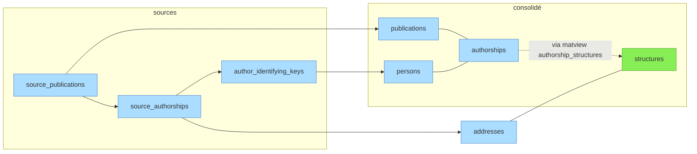

# Vue d'ensemble

*À jour le 2026-10-12.*

## Entités principales et relations

Les trois principales entités métier sont matérialisées dans trois tables: `publications`, `persons`, `structures`.

Une quatrième table `authorships` matérialise la relation entre les trois. Une `authorship` représente la contribution d'**un** auteur à **une** publication. Ses attributs :
- rôle (généralement `auteur`, sauf pour les thèses: `rapporteur`, `president_jury`, etc.),
- auteur [correspondant](../glossaire.md#auteur-correspondant) ou non,
- position auteur (= ordre dans la liste, pour les publications multi-auteurs),
- et l'information d'[affiliation](../glossaire.md#affiliation) à **une ou plusieurs** structures.

## Séparation sources / vue consolidée

Le modèle repose sur la séparation stricte entre les tables **sources** et le **référentiel** que le pipeline en consolide.

- Les tables sources contiennent les *records* non dédupliqués, normalisés à partir des payloads des API tierces.
- Le référentiel contient les **publications** et les **personnes**, obtenues des sources par résolution d'entités, ainsi que les **structures**, saisies manuellement.

Légende:
- **vert** : table peuplée manuellement
- **bleu** : tables peuplées automatiquement par le pipeline

## Schémas PostgreSQL

Les tables se répartissent en un schéma par domaine. Le `search_path` de la base liste ces schémas : les requêtes nomment les tables sans leur schéma. Les types énumérés, les extensions et `alembic_version` sont dans `public`.

- [`sources`](02-sources.md) — tables sources et staging
- [`publications`](03-publications.md) — référentiel consolidé, authorships, sujets
- [`publishing`](04-publishing.md) — revues, monographies, éditeurs, APC
- [`persons`](05-persons.md) — référentiel consolidé, identifiants, name forms, données RH, décisions humaines sur les signatures
- [`structures`](06-structures.md) — référentiel institutionnel, périmètres, adresses
- [`ref` et `ops`](07-ref-et-ops.md) — référentiels externes (pays, langues, ROR) et exploitation (configuration, journaux)

Pages transverses :

- [Données dérivées](08-donnees-derivees.md) — vues matérialisées, tables et colonnes dérivées, et leur fraîcheur (incrémental ou recalcul complet)
- [Index des tables](09-index-des-tables.md) — vue macro du modèle et catalogue complet des tables et vues
