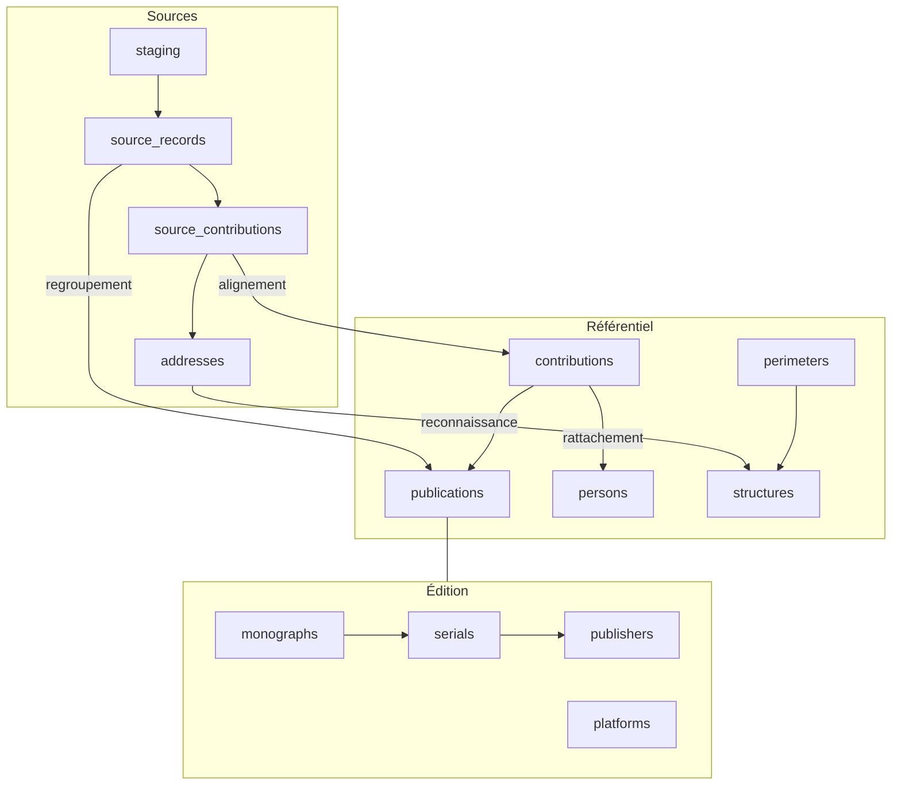

# Modèle de données

*À jour le 2026-10-26.*

Le modèle sépare ce que disent les sources du référentiel que le pipeline en déduit.

| Niveau | Notion | Table | Définition |
|---|---|---|---|
| source | enregistrement source | `source_records` | Description d'un document par une source (HAL, OpenAlex, Crossref…) |
| source | contribution source | `source_contributions` | Personne telle que la source la nomme dans un enregistrement source, avec son rôle (auteur, direction de thèse, jury…) |
| référentiel | publication | `publications` | Document unique, qui réunit les enregistrements sources qui le décrivent |
| référentiel | contribution | `contributions` | Participation d'une personne à une publication, qui réunit ses contributions sources |
| référentiel | personne | `persons` | Personne réelle, identifiée à travers les sources |
| référentiel | structure | `structures` | Établissement, laboratoire, équipe, site ou service |

## Pages

- [Enregistrements sources](02-sources.md), avec les contributions sources et le moissonnage
- [Publications](03-publications.md), avec leurs relations et leurs sujets
- [Contributions](04-contributions.md)
- [Personnes](05-persons.md), avec les décisions humaines sur le rattachement des contributions
- [Structures, périmètres et adresses](06-structures.md)
- [Édition](07-publishing.md) : publications en série, monographies, éditeurs, plateformes, frais de publication
- [Référentiels externes et exploitation](08-ref-et-ops.md)
- [Données dérivées](09-donnees-derivees.md) : vues matérialisées, colonnes dérivées, files de recalcul
- [Index des tables](10-index-des-tables.md)

Chaque domaine a son schéma PostgreSQL. Le `search_path` de la base liste ces schémas, et les requêtes nomment les tables sans leur schéma.
