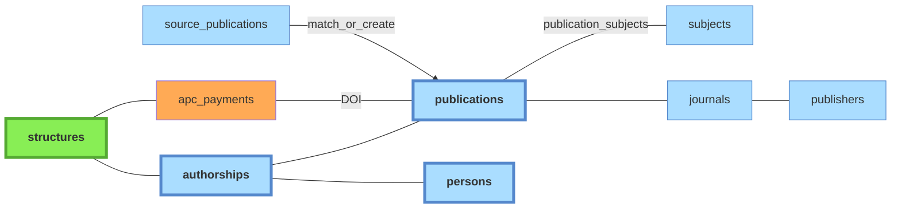

# Schéma `publications`

*À jour le 2026-10-12.*

Référentiel consolidé des productions de recherche et de leurs contributions. Cf [doc pipeline](../pipeline/07-publications.md) pour la logique de résolution d'entités.

Légende :
- **vert** : tables peuplées manuellement
- **orange** : imports CSV
- **bleu** : tables peuplées automatiquement par le pipeline à partir des imports API

## Tables associées

- **`publications_detail`** : satellite 1:1 de `publications` qui contient les métadonnées volumineuses. Cf. [données dérivées](08-donnees-derivees.md).
- **`publication_relations`** : relations sémantiques entre publications distinctes mais apparentées (preprint ↔ version publiée, supplément ↔ article, erratum ↔ article corrigé…). Peuplée par la phase `relations`.

## `authorships` — table consolidée des contributions

Table de liaison recensant les contributions individuelles aux publications. Chaque entrée référence **1 personne**, **1 publication**, *n* structures (via la matview `authorship_structures`). Construite par `pipeline/transformation/publications/authorships/build_authorships.py` à partir des *authorships* sources.

**Couverture partielle assumée** : la table contient seulement les signataires ayant une `person_id`. Les co-auteurs hors périmètre sont absents ; la liste exhaustive des auteurs d'une publication se lit dans `source_authorships`.

Colonnes notables :

- `in_perimeter` : TRUE si l'auteur signe cette publication depuis une structure du périmètre
- `roles` (text[]) : rôles (auteur, directeur, rapporteur — pour theses.fr)

`authorship_structures (authorship_id, structure_id)` donne les affiliations résolues. C'est une **vue matérialisée**, réunion des `source_authorship_structures` des signatures qui attestent l'authorship (même publication par leur notice, même personne), rafraîchie par le pipeline en fin de phase `authorships`.

**Une édition d'administration laisse la vue matérialisée en l'état.** La review d'un lien adresse ↔ structure et l'assignation d'une signature orpheline recalculent `in_perimeter` en direct, mais l'agrégation des structures reste sur l'état de la dernière exécution du pipeline.

**Cohérence avec les sources** : la table est **entièrement dérivée** des `source_authorships`. `in_perimeter`, les liens via `authorship_structures`, `is_corresponding`, `author_position` et `roles` en sont des consolidations, par union ou par priorité de source. Les décisions humaines sont dans le [schéma `persons`](05-persons.md#décisions-humaines).

## Sujets / mots-clés

Trois tables alimentées par la phase `subjects` du pipeline :

- **`subjects`** : référentiel des sujets/mots-clés indexés.
- **`publication_subjects`** : table de liaison publication ↔ sujet (avec score / source).
- **`subject_cooccurrences`** : matrice de co-occurrences entre sujets, alimentée à partir de `publication_subjects`.

## Propriété des tables

| Table | Auteur | Écrit par |
|---|---|---|
| `publications` | pipeline | `pipeline/transformation/publications/reconciliation/refresh.py` (`refresh_from_sources` recalcule depuis les sources) |
| `publications_detail` | pipeline | `pipeline/transformation/publications/reconciliation/refresh.py` |
| `publication_relations` | pipeline | phase `relations` |
| `authorships` | pipeline | `build_authorships.py` (consolidée depuis les sources) |
| `subjects`, `publication_subjects` | pipeline | `pipeline/transformation/publications/subjects/subject_ingestion.py` |
| `subject_cooccurrences` | pipeline | `pipeline/transformation/publications/subjects/subject_cooccurrences.py` (matview) |
