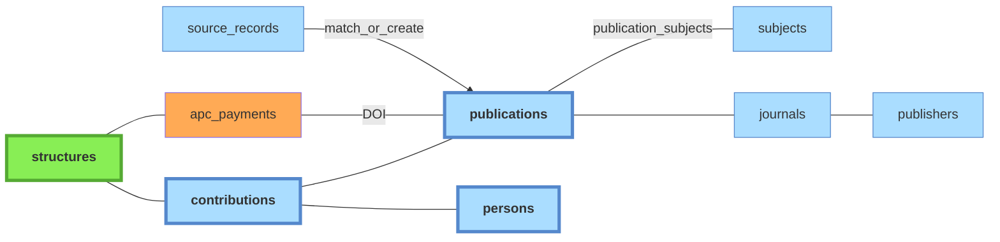

# Schéma `publications`

*À jour le 2026-10-12.*

Référentiel consolidé des productions de recherche et de leurs contributions. Cf [doc pipeline](../pipeline/07-publications.md) pour la logique de résolution d'entités.

Légende :
- **vert** : tables peuplées manuellement
- **orange** : imports CSV
- **bleu** : tables peuplées automatiquement par le pipeline à partir des imports API

## Tables associées

- **`publications_detail`** : satellite 1:1 de `publications` qui contient les métadonnées volumineuses. Cf. [données dérivées](08-donnees-derivees.md).
- **`publication_relations`** : relations sémantiques entre publications distinctes mais apparentées (preprint ↔ version publiée, supplément ↔ article, erratum ↔ article corrigé…). Peuplée par la phase `relations`.

## `contributions` — contributions des auteurs aux publications

Une contribution réunit les contributions sources d'un même auteur dans une publication, une par enregistrement source au plus (`aligned_source_contributions`). Elle est formée par la phase `author_grouping`. Elle désigne la personne de l'auteur (`person_id`) et le mode du rattachement (`resolution_mode`), ou aucune personne : elle est alors orpheline. Une personne a au plus une contribution par publication. Les contributions sources collectives, les doublons d'auteur et les contributions sources des enregistrements sources écartés de l'alignement ne sont dans aucune contribution.

Colonnes notables :

- `reference_position` : position de l'auteur dans la liste d'auteurs la plus longue
- `perimeter_evidence`, `in_perimeter` : indices de périmètre, union de ceux des contributions sources alignées ; `in_perimeter` est vrai dès qu'il y a un indice
- `roles` (text[]), `is_corresponding` : union de ceux des contributions sources alignées

`contribution_structures (contribution_id, structure_id)` donne les affiliations résolues des contributions rattachées à une personne non exclue. C'est une **vue matérialisée**, réunion des `source_contribution_structures` de leurs contributions sources alignées, rafraîchie par la phase `finalize`.

**Une édition d'administration laisse la vue matérialisée en l'état.** La review d'un lien adresse ↔ structure et l'attribution d'une contribution orpheline recalculent `in_perimeter` en direct, mais l'agrégation des structures reste sur l'état de la dernière exécution du pipeline.

Les décisions humaines sont dans le [schéma `persons`](05-persons.md#décisions-humaines).

## Sujets / mots-clés

Trois tables alimentées par la phase `subjects` du pipeline :

- **`subjects`** : référentiel des sujets/mots-clés indexés.
- **`publication_subjects`** : table de liaison publication ↔ sujet (avec score / source).
- **`subject_cooccurrences`** : matrice de co-occurrences entre sujets, alimentée à partir de `publication_subjects`.

## Propriété des tables

| Table | Auteur | Écrit par |
|---|---|---|
| `publications` | pipeline | `pipeline/transformation/publications/consolidation.py` (`refresh_from_sources` recalcule depuis les sources) |
| `publications_detail` | pipeline | `pipeline/transformation/publications/store.py` |
| `publication_relations` | pipeline | phase `relations` |
| `contributions`, `aligned_source_contributions` | mixte | alignement par la phase `author_grouping`, personne par la phase `persons` (`pipeline/transformation/persons/groups.py`) ; décisions de l'administration (`application/services/contributions/`) |
| `subjects`, `publication_subjects` | pipeline | `pipeline/transformation/publications/subjects/subject_ingestion.py` |
| `subject_cooccurrences` | pipeline | `pipeline/transformation/publications/subjects/subject_cooccurrences.py` (matview) |
