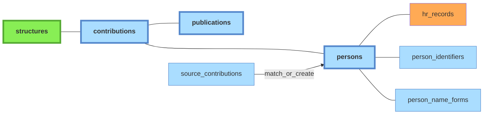

# Schéma `persons`

*À jour le 2026-10-12.*

Référentiel des individus.

**Périmètre** : `persons` couvre les personnes qui ont au moins une contribution source dans le périmètre. Conséquence : les co-auteurs externes des publications UCA n'ont pas de personne.

Légende :
- **vert** : tables peuplées manuellement
- **orange** : imports CSV
- **bleu** : tables peuplées automatiquement par le pipeline à partir des imports API

## Tables associées

- **`hr_records`** : fiches RH, table satellite liée à `persons` (FK `person_id`, ON DELETE RESTRICT). Contient les données issues des exports RH : cf [doc sources](../sources/10-imports-manuels.md#extraction-rh).
- **`person_identifiers`** : identifiants de personne, persistants — [ORCID](../glossaire.md#orcid), [idHAL](../glossaire.md#idhal), [IdRef](../glossaire.md#idref), etc. Chaque ligne associe un identifiant (`id_type` + `id_value`) à une personne (`person_id`). Le champ `source` dit d'où vient l'attribution — `manual` pour une décision humaine, `auto` pour une résolution du pipeline — et `status` où elle en est : `pending`, `confirmed`, `rejected` ou `authenticated`. La relation *many-to-one* permet de gérer les quelques cas d'ORCID multiples confirmés, et les nombreux cas d'identifiants (corrects ou erronés) en attente de vérification moissonnés dans les sources.
- **`person_name_forms`** : formes de noms normalisées, servant à reconnaître une personne existante lors de la création.
- **`distinct_persons`** : paires de personnes déclarées **distinctes malgré une forme de nom commune** ; les files de triage par nom et par identifiant du référentiel `admin/persons` écartent la paire.

## Décisions humaines

Deux tables contiennent les arbitrages saisis à la main sur les contributions sources, et survivent aux reconstructions de la table `contributions` :

- **`rejected_contributions`** — contributions rejetées : paires (publication, personne) écartées, enregistrées sur chaque enregistrement source de la publication. Clé primaire `(source_record_id, person_id)`.
- **`confirmed_source_contributions`** — contributions sources confirmées : contributions sources épinglées sur une personne. Clé primaire `source_contribution_id`.

## Propriété des tables

| Table | Auteur | Écrit par |
|---|---|---|
| `persons` | mixte | créées par le pipeline (phase persons, `pipeline/transformation/persons/groups.py`) ou par l'import RH (`import_persons.py`) ; fusions, renommage et rejet en admin (`application/services/persons/commands.py`) |
| `person_identifiers` | mixte | moissonnés par le pipeline ; ajout manuel et statut en admin (`application/services/persons/commands.py`) |
| `person_name_forms` | mixte | peuplées par le pipeline (`populate_person_name_forms.py`) ; statut en admin |
| `distinct_persons` | admin | `application/services/persons/commands.py` |
| `hr_records` | import CSV | `interfaces/cli/imports/import_persons.py` |
| `rejected_contributions` | admin | `application/services/contributions/core.py` |
| `confirmed_source_contributions` | admin | `application/services/contributions/assign_orphans.py` |
