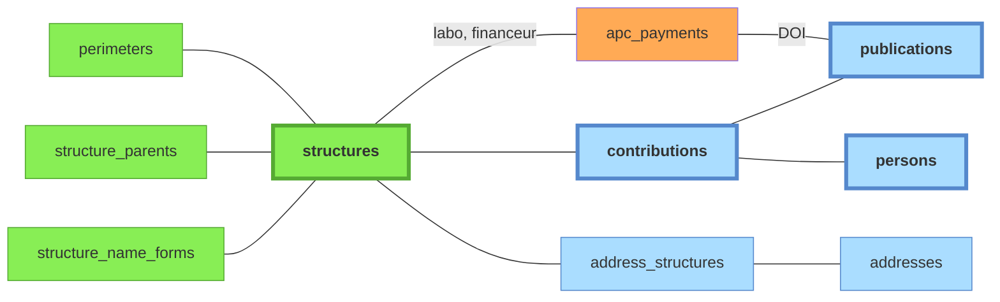

# Schéma `structures`

*À jour le 2026-10-12.*

Référentiel de structures maintenu manuellement, périmètres et adresses.

Colonnes notables de `structures` :

- `code` : identifiant court stable (`uca`, `cnrs`, `lpc`, `ip`)
- `structure_type` : `universite`, `onr`, `chu`, `ecole`, `labo`, `equipe`, `site`, `admin`, `autre`
- `ror_id` : identifiant [ROR](../glossaire.md#ror)
- `rnsr_id` : identifiant RNSR
- `hal_collection` : collection HAL associée
- `api_ids` : identifiants dans les sources API (OpenAlex, etc.)

Légende :
- **vert** : tables peuplées manuellement
- **orange** : imports CSV
- **bleu** : tables peuplées automatiquement par le pipeline à partir des imports API

## Tables associées

- **`perimeters`** : un périmètre est un ensemble de structures, incluant récursivement les sous-structures. Les périmètres se saisissent en admin, et le pipeline lit dans `config` celui qui vaut à chaque étape. Un périmètre décide :
  - des critères d'affiliation utilisés en paramètre des requêtes API lors du moissonnage ;
  - des `source_contributions` qui fournissent les candidats à la résolution des `publications` et des `persons`.
- **`perimeter_structures`** : appartenance au périmètre, matérialisée par clôture récursive des tutelles. Cf. [données dérivées](09-donnees-derivees.md).
- **`structure_parents`** : tutelles, rattachement hiérarchique d'une structure à une autre. C'est la seule relation entre structures du modèle, et sa clôture récursive décide des **structures incluses ou non dans un périmètre**. Le graphe reste sans cycle : une structure ne peut se rattacher à elle-même ni à l'un de ses descendants.
- **`structure_name_forms`** : formes de noms pour la détection automatique des structures dans les adresses liées aux publications. Le champ `requires_context_of` (= liste d'id structures) permet de rendre une forme de nom *conditionnellement* valide. Cette table est utilisée dans la phase `affiliations` du [pipeline](../pipeline/04-affiliations.md) pour peupler la table de liaison `address_structures`.
- **`address_structures`** : table de liaison. Les adresses proviennent des contributions sources (peuplées via `source_contribution_addresses` lors de la phase `normalize`, exploitées lors de la phase `affiliations`). Les structures identifiées sont ensuite propagées aux contributions sources.

## Pages admin associées

- [**admin/structures**](../guide-utilisateur/02-pages-admin.md#structures) : CRUD des structures, de leurs tutelles et de leurs formes de nom.
- [**admin/config**](../guide-utilisateur/02-pages-admin.md#configuration) : CRUD des périmètres et choix du périmètre actif aux différentes étapes du pipeline.

## Propriété des tables

| Table | Auteur | Écrit par |
|---|---|---|
| `structures` | admin | `application/services/structures.py` |
| `structure_parents` | admin | `application/services/structures.py` |
| `structure_name_forms` | admin | `application/services/structures.py` |
| `perimeters` | admin | `application/services/perimeters.py` |
| `perimeter_structures` | pipeline | `refresh_perimeter_structures`, jamais saisie |
| `addresses` | pipeline | créées par `normalize` (`pipeline/ingestion/common/source_contributions.py`) ; `countries` composé par la phase `countries` |
| `address_country_candidates` | mixte | pays trouvés par le pipeline (phases `normalize` et `countries`) ; candidats `manual` saisis en admin (`addresses/commands.py`) |
| `address_structures` | mixte | liens posés par le pipeline (`pipeline/transformation/structures/address_resolution.py`) ; colonne `is_confirmed` posée en admin (`addresses/commands.py`) |
