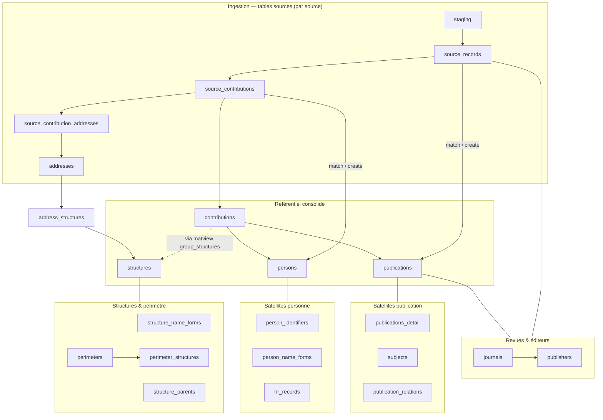

# Index des tables

*À jour le 2026-10-12.*

## Vue macro

Vue globale du modèle : l'ingestion par source en haut, les référentiels consolidés au centre, et les satellites rattachés à leur entité-pivot. Seules les tables principales y figurent ; l'index ci-dessous est exhaustif.

## Index alphabétique

Les vues et vues matérialisées sont signalées comme telles.

| Objet | Description | Schéma |
|---|---|---|
| `address_country_candidates` | pays proposés pour une adresse par chaque moyen de détection | [structures](06-structures.md) |
| `address_structures` | liaison adresse ↔ structure (avec confirmation) | [structures](06-structures.md) |
| `addresses` | adresses normalisées issues des contributions sources | [structures](06-structures.md) |
| `alembic_version` | révision de schéma appliquée — technique | `public` |
| `apc_payments` | frais de publication (import CSV) | [publishing](04-publishing.md) |
| `audit_log` | journal des événements (actions admin, fusions) — technique | [ops](07-ref-et-ops.md) |
| `contributor_information` | informations du contributeur d'une contribution source (nom normalisé, identifiants), partagés via `contributor_information_id` | [sources](02-sources.md) |
| `group_structures` | *vue matérialisée* : structures liées à un groupe de contributions sources | [publications](03-publications.md) |
| `contributions` | table consolidée personne × publication | [publications](03-publications.md) |
| `candidate_dois` | *vue* : DOI des publications du périmètre, lus par le rattrapage par DOI et la résolution des agences d'enregistrement | [sources](02-sources.md) |
| `config` | réglages d'exploitation du pipeline (périmètres actifs, années couvertes…) | [ops](07-ref-et-ops.md) |
| `confirmed_source_contributions` | épinglages admin (must-link) contribution source ↔ personne, réappliqués à chaque exécution | [persons](05-persons.md) |
| `countries` | référentiel des pays | [ref](07-ref-et-ops.md) |
| `distinct_persons` | paires marquées distinctes malgré un nom commun | [persons](05-persons.md) |
| `doi_prefixes` | cache préfixe DOI → agence + éditeur | [publishing](04-publishing.md) |
| `failed_lookups` | identifiants cherchés en vain dans une source, avec la date de l'échec | [sources](02-sources.md) |
| `journal_doi_namespaces` | espaces de noms DOI qui désignent une revue | [publishing](04-publishing.md) |
| `journal_issns` | ISSN des revues | [publishing](04-publishing.md) |
| `journal_name_forms` | formes de noms pour reconnaître une revue | [publishing](04-publishing.md) |
| `journals` | référentiel des revues | [publishing](04-publishing.md) |
| `language_forms` | formes sous lesquelles les sources désignent une langue | [ref](07-ref-et-ops.md) |
| `languages` | référentiel des langues | [ref](07-ref-et-ops.md) |
| `monographs` | livres et volumes d'actes de congrès | [publishing](04-publishing.md) |
| `perimeter_structures` | appartenance au périmètre, recalculée par le pipeline | [structures](06-structures.md) |
| `perimeters` | définition des périmètres | [structures](06-structures.md) |
| `person_identifiers` | identifiants persistants (ORCID, idHAL, IdRef) | [persons](05-persons.md) |
| `person_name_forms` | formes de noms pour reconnaître une personne | [persons](05-persons.md) |
| `persons` | référentiel des personnes du périmètre | [persons](05-persons.md) |
| `hr_records` | satellite des données RH (import CSV) | [persons](05-persons.md) |
| `pipeline_phase_executions` | historique d'exécution des phases — technique | [ops](07-ref-et-ops.md) |
| `place_name_forms` | formes de noms pour la détection des pays | [ref](07-ref-et-ops.md) |
| `publication_relations` | relations sémantiques entre publications | [publications](03-publications.md) |
| `publication_structures` | *vue matérialisée* : structures d'une publication | [publications](03-publications.md) |
| `publication_subjects` | liaison publication ↔ sujet | [publications](03-publications.md) |
| `publications` | référentiel consolidé des productions | [publications](03-publications.md) |
| `publications_detail` | satellite 1:1 (abstract, keywords, topics, biblio) | [publications](03-publications.md) |
| `publisher_name_forms` | formes de noms pour reconnaître un éditeur | [publishing](04-publishing.md) |
| `publishers` | référentiel des éditeurs | [publishing](04-publishing.md) |
| `rejected_contributions` | rejets manuels de paires personne × publication | [persons](05-persons.md) |
| `ror_dump_imports` | imports du dump ROR | [ref](07-ref-et-ops.md) |
| `ror_organizations` | organisations du Research Organization Registry | [ref](07-ref-et-ops.md) |
| `ror_relations` | relations parent/enfant entre organisations ROR | [ref](07-ref-et-ops.md) |
| `source_contribution_addresses` | liaison contribution source ↔ adresse | [sources](02-sources.md) |
| `source_contribution_rors` | ROR attribués par la source à une contribution source, rattachés à l'adresse de leur affiliation | [sources](02-sources.md) |
| `source_contribution_structures` | *vue matérialisée* : affiliations résolues d'une contribution source | [sources](02-sources.md) |
| `source_contributions` | contribution d'un auteur source à un document source | [sources](02-sources.md) |
| `source_records` | un enregistrement par document par source | [sources](02-sources.md) |
| `staging` | ingestion brute par source, payload vidé après normalisation | [sources](02-sources.md) |
| `structure_name_forms` | formes de noms pour la détection des structures | [structures](06-structures.md) |
| `structure_parents` | rattachement hiérarchique entre structures | [structures](06-structures.md) |
| `structures` | référentiel institutionnel | [structures](06-structures.md) |
| `subject_cooccurrences` | *vue matérialisée* : paires de sujets co-présents | [publications](03-publications.md) |
| `subjects` | référentiel des sujets / mots-clés | [publications](03-publications.md) |
