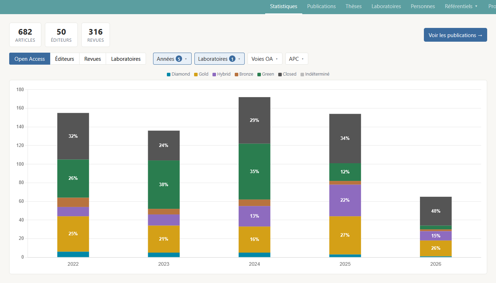
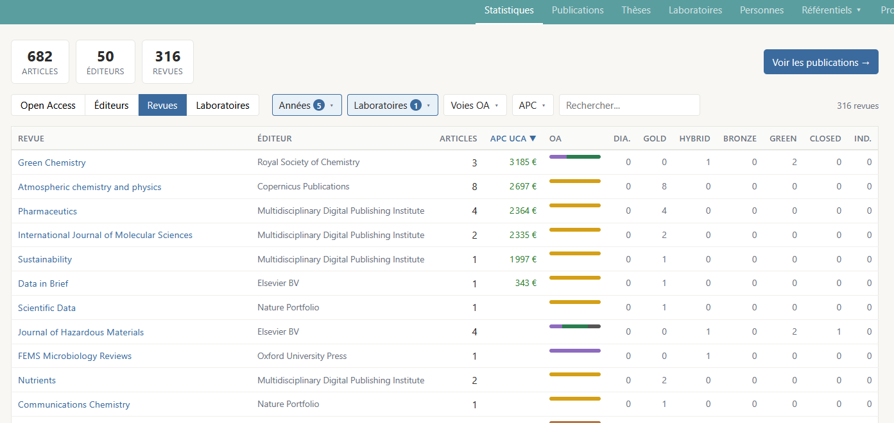
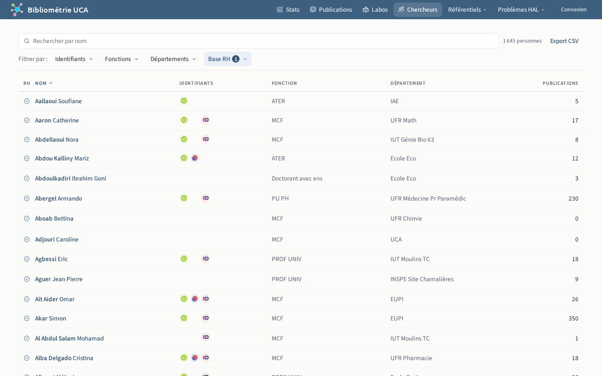
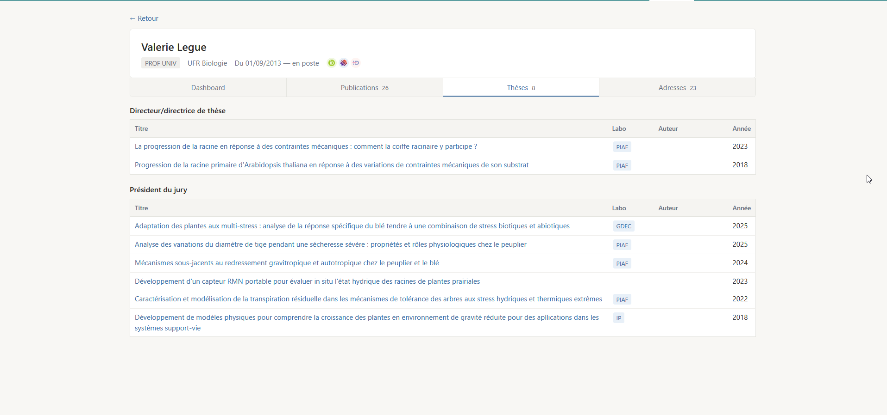
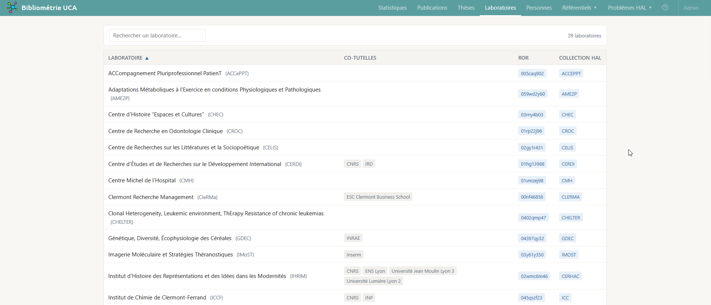
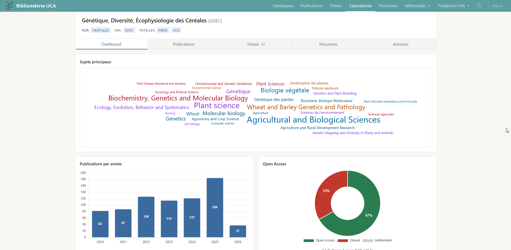

# Pages publiques

*A compléter et mettre à jour*

## Statistiques

`/stats`

Graphique exportable en png. L'indicateur choisit ce que montre chaque barre :
- nombre de publications par type de production, par accès, par [voie *open access*](../glossaire.md#voies-open-access) ou par licence ;
- montant des APC payées par l'établissement, par voie *open access* ;
- collaborations internationales, sur une carte.

Les barres se comparent par année, laboratoire, éditeur, revue ou [organisation partenaire](../glossaire.md#organisation-partenaire), en nombre ou en part.

Les filtres sont ceux de la liste des publications, sauf la recherche, le statut HAL, l'auteur correspondant et le périmètre. Par défaut, la page retient la famille « Publications » et les années récentes.

Le bouton « Voir les publications » ouvre la liste sous les mêmes filtres. En sens inverse, le bouton « Statistiques » de la liste ouvre la page sous les filtres de la liste ; une notification nomme ceux que la page ne prend pas en compte.

## Publications

### Liste `/publications`

Liste des publications filtrable par :
- type de document,
- année de publication,
- laboratoires,
- accès (ouvert/fermé),
- [voie *open access*](../glossaire.md#voies-open-access),
- licence de la version éditeur,
- paiement d'[APC](../glossaire.md#apc),
- pays des co-auteurs,
- [organisation partenaire](../glossaire.md#organisation-partenaire),
- sources.

Filtre de recherche (interroge le titre et les sujets liés).

Export csv.

Certaines colonnes+facettes sont masquées par défaut: un bouton permet de choisir les colonnes affichées.

### Détails `/publications/{id}`

Vue détaillée : métadonnées, licences de la version éditeur et du dépôt HAL, auteurs. Le bouton « Accéder » mène à la meilleure copie ouverte, à défaut au DOI. La section « Accès » donne la meilleure copie ouverte de chaque plateforme : la version éditeur passe avant la version acceptée, puis la version soumise. La section « Référencé par » donne les bases qui référencent la publication sans en donner de copie.

Vue alignée des auteurs par source pour détecter d'éventuelles incohérences.<!--TODO: à supprimer de l'UI publique, à réserver à une future page admin.-->

## Thèses

`/theses`

TODO: à compléter

(La page "détails thèse" est la même que "détails publication".)

## Personnes

### Liste `/persons`

Liste des personnes avec leurs identifiants (ORCID, idHAL) et affiliations.
Filtrable par:
- présence ou non dans la [base RH](../sources/10-imports-manuels.md#extraction-rh),
- données RH (rôle, affiliation),
- identifiants (ORCID, idHAL).

### Détails `/persons/{id}`

Vue détaillée d'un chercheur. Identifiants, données RH si existent.
3 ou 4 onglets:
- dashboard
- publications
- thèses, si la personne est liée à une ou plusieurs thèses
- adresses (adresses liées à cette personne dans les publications)
<!-- TODO: Distinguer les onglets visibles selon rôle utilisateur: les onglets "identités" et "adresses" sont des outils internes, sans intérêt pour le chercheur -->
<!-- TODO: Onglet adresses des pages personnes/id et laboratoire/id: afficher nombre de publications liées à chaque adresse; créer possibilité de consulter la liste?; normaliser adresses pour diminuer le nombre de variantes liées à des différences de ponctuation? -->

## Laboratoires

### Liste `/structures`

Liste des structures avec tutelles, identifiant ROR et lien vers collection HAL. Une facette de type est réglée par défaut sur les laboratoires.

### Détails `/structures/{id}`

Vue détaillée d'une structure.

Onglets:
- Dashboard (sujets, production, taux d'open access, collaborations internationales);
- Publications;
- Thèses;
- Personnes: affiche les personnes liées à ce laboratoire via une publication (ne repose pas sur l'affiliation renseignée dans la base RH);
- Collaborations: [organisations partenaires](../glossaire.md#organisation-partenaire), classées par nombre de copublications, filtrables par année, pays et type; le nombre de copublications mène à la liste des publications concernées;
- Adresses (adresses ayant permis la détection de ce laboratoire dans les publications), en session d'administration ;
- Gestion (édition, tutelles, formes de nom), en session d'administration.

## Revues

### Liste `/journals`

Liste des revues avec filtres : recherche par titre ou ISSN, éditeur, type de revue, présence dans le DOAJ, modèle open access. La recherche par ISSN interroge les trois colonnes de support et les ISSN rejetés, avec ou sans tiret. Le filtre éditeur propose les éditeurs les plus représentés sous les filtres actifs, avec leur nombre de revues, et se cherche par nom. Triable par nombre de publications.

### Détails `/journals/{id}`

Vue détaillée d'une revue. Onglets : Dashboard, Publications.

## Éditeurs

### Liste `/publishers`

Liste des éditeurs avec leurs revues associées et leur volume de publications.

### Détails `/publishers/{id}`

Vue détaillée d'un éditeur. Onglets : Dashboard, Revues, Publications.

## Sujets

### Liste `/subjects`

### Détails `/subjects/{id}`

## Problèmes HAL

`/hal-problems/*`

Pages dédiées à relever les problèmes de qualité spécifiques à HAL :

- **Comptes auteur en double** : auteurs HAL ayant plusieurs comptes
- **Dépôts en double** : dépôts HAL d'une même publication
- **Publications absentes des collections** : publications HAL absentes de la collection HAL de leur laboratoire
- **Affiliations divergentes** : publications affiliées à l'établissement dans HAL, sans cette affiliation dans les autres sources
