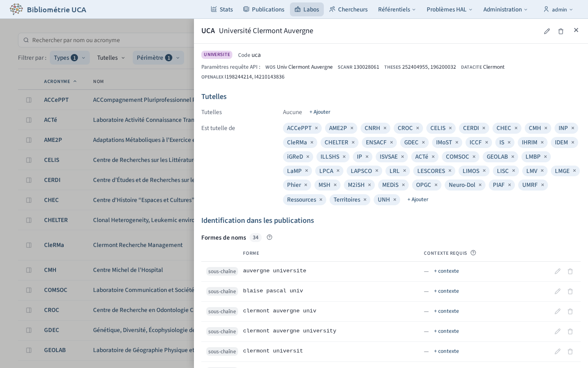
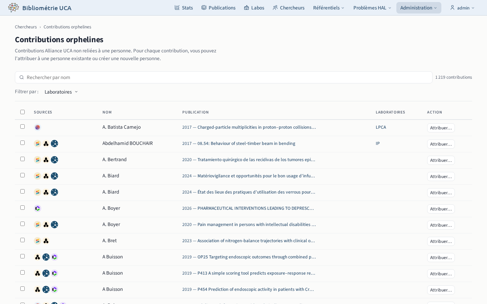
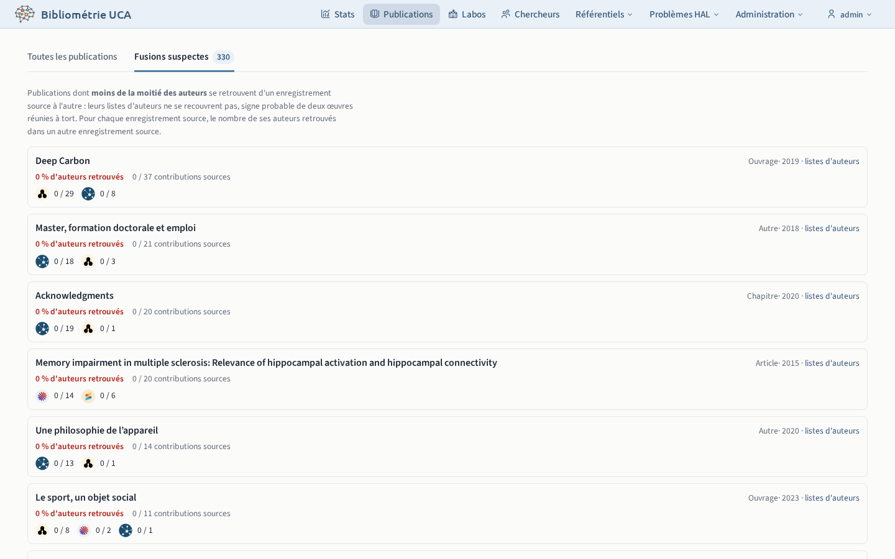

# Référentiels

## Labos

`/structures`, en session d'administration

Le volet de gestion d'une structure règle ses détails, ses tutelles et ses formes de nom. Les formes de nom servent à reconnaître la structure dans les adresses des publications.

## Chercheurs

`/persons`, en session d'administration

Le volet de gestion d'une personne permet :

- **Exclusion** : écarter une fausse personne (nom mal découpé, nom d'équipe de recherche) ou une personne rattachée à l'établissement par erreur.
- **Identifiants** : chaque identifiant attribué par le pipeline est en attente, confirmé ou rejeté.
- **Formes de nom** : une forme partagée avec une autre personne est ambiguë. Une forme ouvre la liste des contributions qu'elle rattache, que l'on peut détacher.
- **Fusion** : réunir deux personnes en double. La fusion exige qu'au plus une des deux ait une fiche RH.

### Contributions orphelines `/admin/orphan-contributions`

[Contributions](../../glossaire.md#contribution) de l'établissement sans personne, à attribuer à une personne existante ou nouvelle.

## Publications

`/publications`, en session d'administration

L'onglet « Fusions suspectes » liste les publications dont les sources donnent des listes d'auteurs très différentes : deux documents distincts ont peut-être été fusionnés à tort.

Le volet d'une publication compare les métadonnées de chaque source, une colonne par source. Une ligne surlignée signale des valeurs différentes selon les sources.

## Éditeurs et publications en série

En session d'administration, la fiche d'un éditeur ou d'une publication en série permet de les modifier et de les fusionner avec un doublon. Changer le type d'une publication en série change le type de ses publications.
