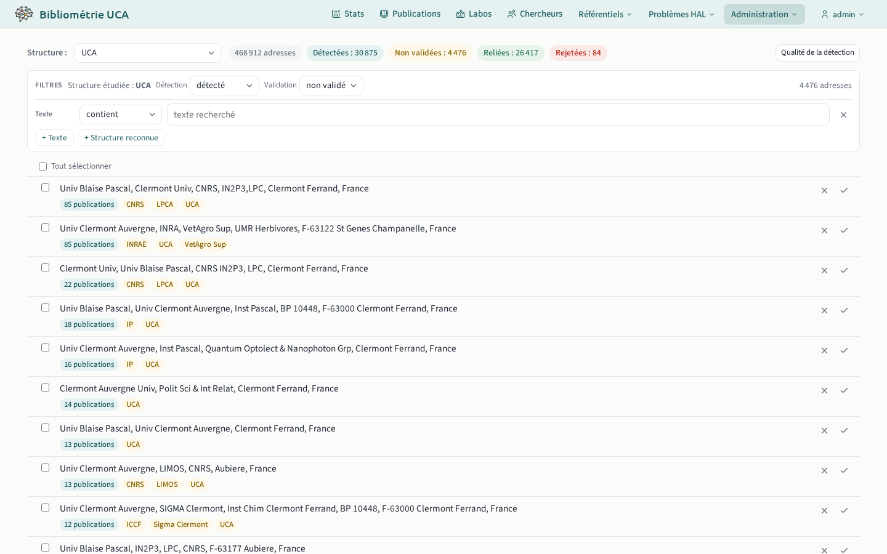
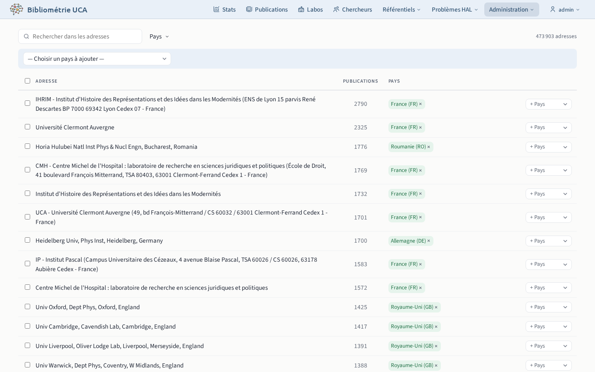

# Adresses

## Affiliations `/admin/addresses`

La [phase `affiliations`](../../pipeline/04-affiliations.md) du pipeline rattache chaque adresse aux structures reconnues par leurs formes de nom. La page permet de confirmer ou de rejeter chaque rattachement.

Le bouton « Qualité de la détection » liste les rattachements créés ou rejetés à la main. Un rattachement créé à la main signale une forme de nom manquante, un rattachement rejeté une forme trop large. Les formes de nom modifiées prennent effet à la prochaine exécution de la phase `affiliations`.

## Onglets Adresses d'une personne et d'une structure

En session d'administration, la fiche d'une personne ou d'une structure à [adresses brutes](../../glossaire.md#adresse-brute) a un onglet Adresses. Il montre seulement ces adresses. La phase [`affiliations`](../../pipeline/04-affiliations.md) en écarte les libellés HAL et les noms seuls.

L'onglet mesure le rattachement des publications dans les bases lues par les classements internationaux : WoS et OpenAlex. Il retient seulement les adresses de ces deux sources, sur les articles, les reviews, les communications, les ouvrages et les chapitres. Pour une personne, il lit ses publications. Pour une structure, il lit les publications de ses membres parues pendant leur période de présence ; une publication datée à l'année ou au mois compte si toute l'année ou tout le mois tombe dans la période. Seules les personnes de la base RH sont membres.

Un graphique compte, par année, les publications avec adresse. Un clic sur une structure de la légende colore, dans chaque barre, les publications dont une adresse est rattachée à la structure, et affiche leur nombre et leur part sur toutes les années. La légende sélectionne d'office la structure de la fiche, ou, sur la fiche d'une personne, la structure la plus fréquente.

## Pays des adresses `/admin/countries`

Correction des pays des adresses. Une correction se propage aux publications, sans relancer le pipeline.

