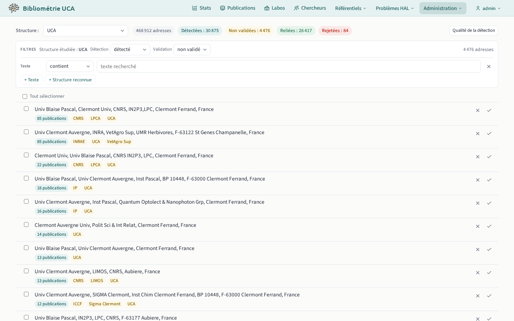
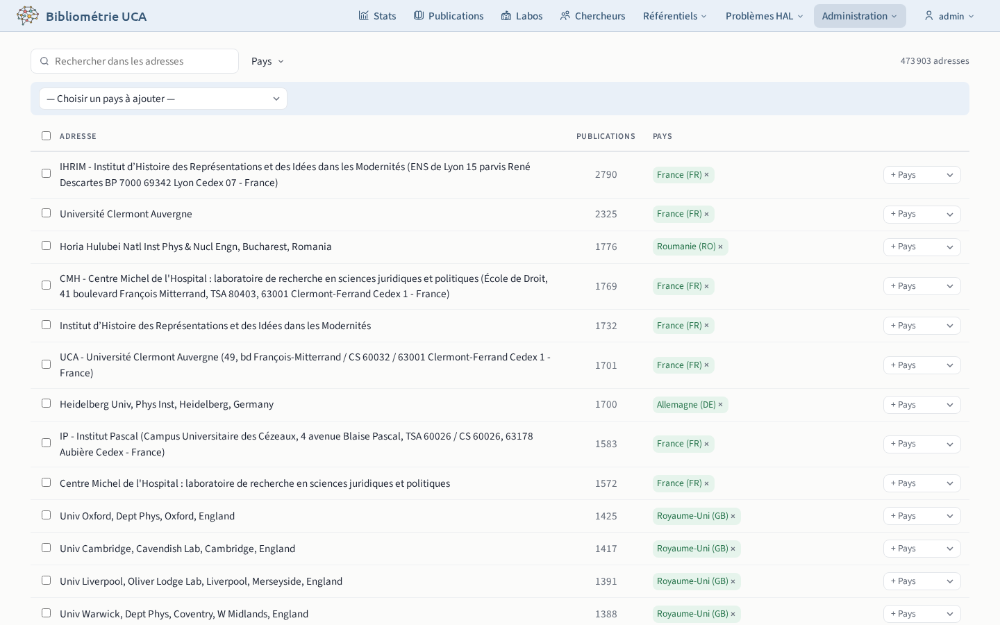

# Adresses

## Affiliations `/admin/addresses`

La [phase `affiliations`](../../pipeline/04-affiliations.md) du pipeline rattache chaque adresse aux structures reconnues par leurs formes de nom. La page permet de confirmer ou de rejeter chaque rattachement.

Le bouton « Qualité de la détection » liste les rattachements créés ou rejetés à la main. Un rattachement créé à la main signale une forme de nom manquante, un rattachement rejeté une forme trop large. Les formes de nom modifiées prennent effet à la prochaine exécution de la phase `affiliations`.

## Onglets Adresses d'une personne et d'une structure

En session d'administration, la fiche d'une personne et celle d'une structure ont un onglet Adresses. Il montre les seules [adresses brutes](../../glossaire.md#adresse-brute). La phase [`affiliations`](../../pipeline/04-affiliations.md) en écarte les libellés HAL et les noms seuls.

## Pays des adresses `/admin/countries`

Correction des pays des adresses. Une correction se propage aux publications, sans relancer le pipeline.

