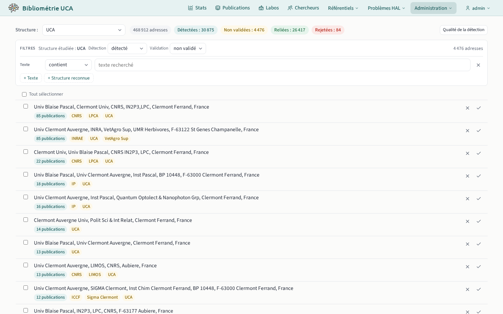
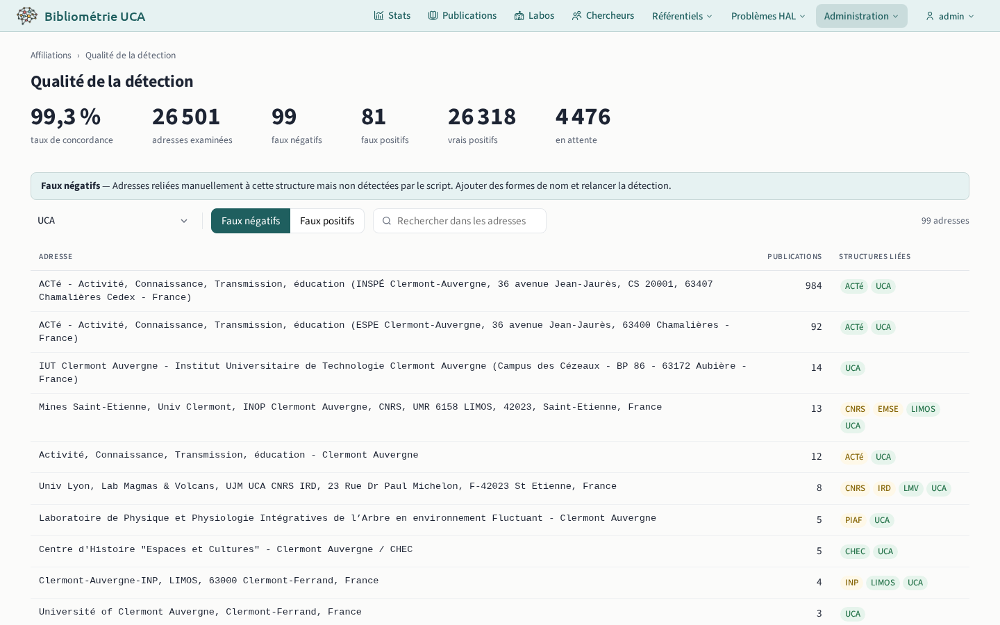

# Adresses

## Affiliations des adresses `/admin/addresses`

Contrôle des adresses d'affiliation résolues par la [phase `affiliations`](../../pipeline/04-affiliations.md) du pipeline : confirmer ou rejeter les associations adresse → structure.

## Qualité de la détection `/admin/feedback`

Faux positifs et faux négatifs de la détection des structures dans les adresses :

- **faux négatifs** : affiliations adresse-structure non détectées par le pipeline mais créées manuellement. Action : repérer les formes de nom non détectées et les ajouter dans le volet de la structure ;
- **faux positifs** : affiliations détectées par le pipeline mais rejetées manuellement. Action : supprimer une forme de nom trop permissive, ou lui ajouter un contexte plus contraignant.

Les ajouts et suppressions de formes de nom prennent effet à la prochaine exécution de la [phase `affiliations`](../../pipeline/04-affiliations.md).

## Pays des adresses `/admin/countries`

Attribution et correction des pays liés aux adresses. Chaque adresse affiche ses pays retenus et les moyens qui les ont trouvés. Les pays trouvés et non retenus sont proposés en pointillés ; un clic ajoute le pays. Les corrections se propagent aux publications liées, sans relancer le pipeline.
