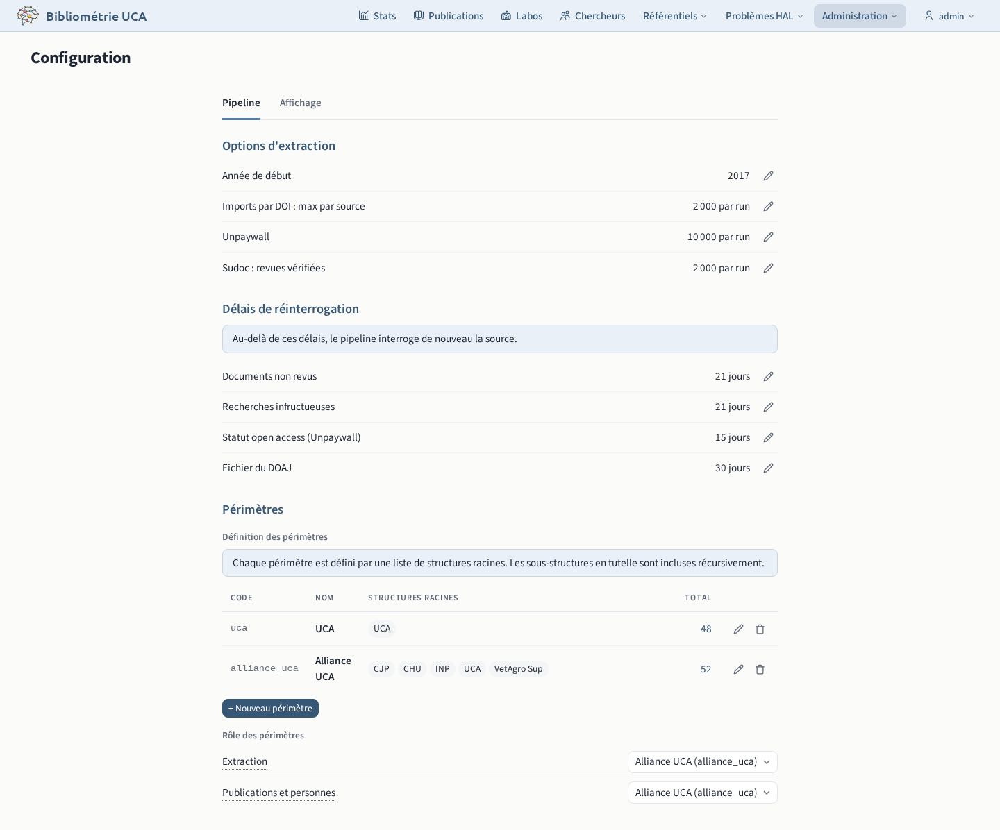
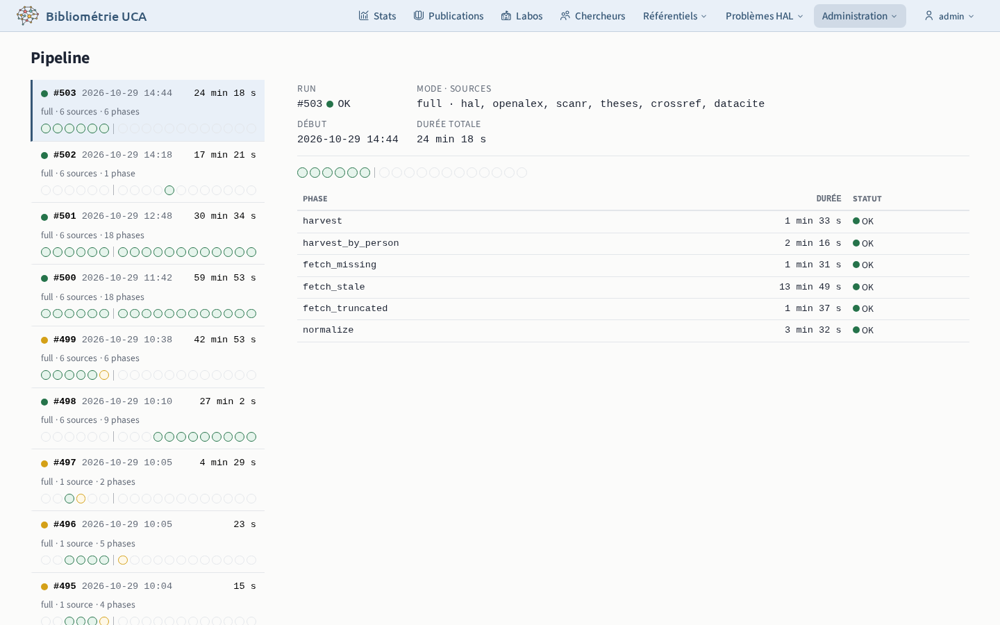

# Pipeline

## Configuration `/admin/config`

Réglages du pipeline : années interrogées, délais de réinterrogation des sources et périmètres. Le [workflow](04-workflow.md#configuration-du-pipeline) décrit chaque réglage.

## Pipeline `/admin/pipeline`

Historique des runs du pipeline.

