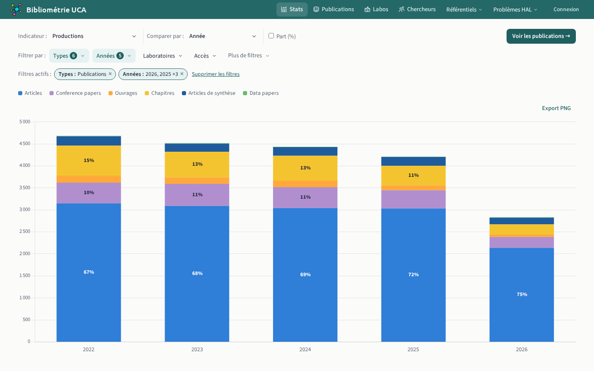

# Statistiques

`/stats`

L'indicateur choisit ce que montre chaque barre :

- nombre de publications par type de production, par accès, par [voie *open access*](../../glossaire.md#voies-open-access) ou par licence ;
- montant des APC payées par l'établissement, par voie *open access* ;
- collaborations internationales, sur une carte.

Les barres se comparent par année, laboratoire, éditeur, revue ou [organisation partenaire](../../glossaire.md#organisation-partenaire), en nombre ou en part. Les filtres sont ceux de la [liste des publications](02-publications.md#liste-publications).

