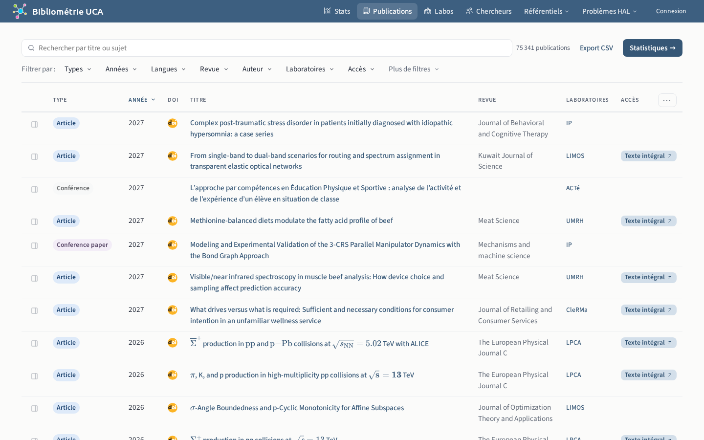
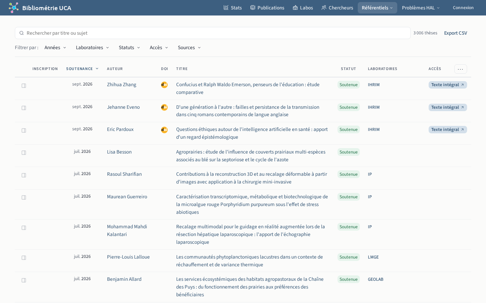

# Publications et thèses

## Liste `/publications`

La recherche interroge le titre et les sujets.

La même liste sert d'onglet aux fiches d'une structure, d'une personne, d'une revue, d'un éditeur, d'une monographie et d'un sujet, restreinte à cette entité.

## Détails `/publications/{id}`

Le bouton « Accéder » mène au texte intégral, à défaut au DOI.

## Thèses `/theses`

Liste des thèses soutenues et en cours. La fiche d'une thèse est celle d'une publication.

