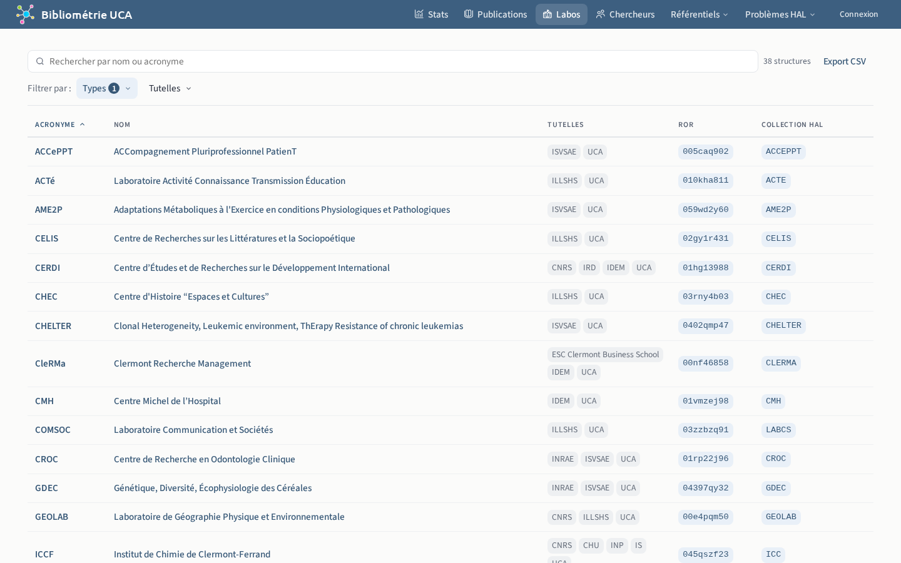
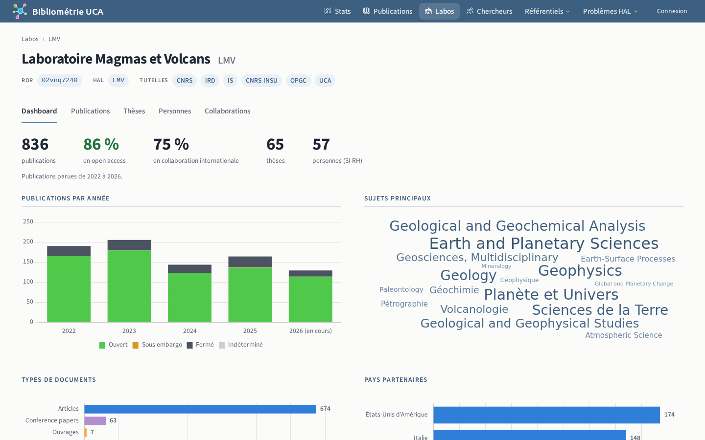
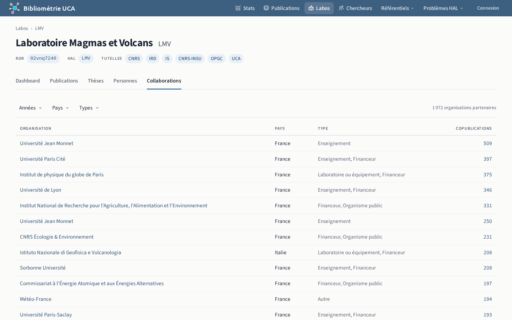

# Labos

## Liste `/structures`

Établissements, organismes de recherche, laboratoires, équipes et services.

## Détails `/structures/{id}`

L'onglet Personnes montre les personnes qui ont publié avec une affiliation à la structure, quelle que soit leur affectation administrative. L'onglet Collaborations classe les [organisations partenaires](../../glossaire.md#organisation-partenaire) par nombre de copublications.

