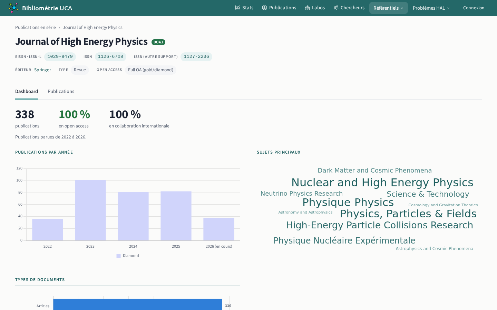
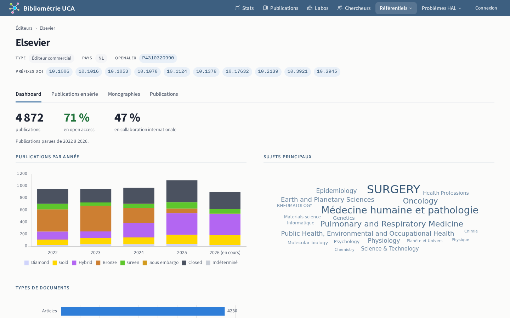

# Publications en série et éditeurs

## Publications en série `/journals`

Revues, séries d'actes de conférence, collections de livres, archives ouvertes, serveurs de preprints et médias.

La facette « Listes » filtre les publications en série par liste de revues : DOAJ, conférence des doyens de médecine, MEDLINE, Leiden Ranking, Diamond Discovery Hub, ERIH PLUS, registre norvégien, FNEGE. Chaque liste reçoit un sélecteur à trois états : indifférent, présente, absente. Sous un classement à niveaux, des cases restreignent la sélection aux niveaux cochés. La page d'une publication en série affiche ses listes ; l'info-bulle de chaque liste donne son organisme et son édition.

## Éditeurs `/publishers`

