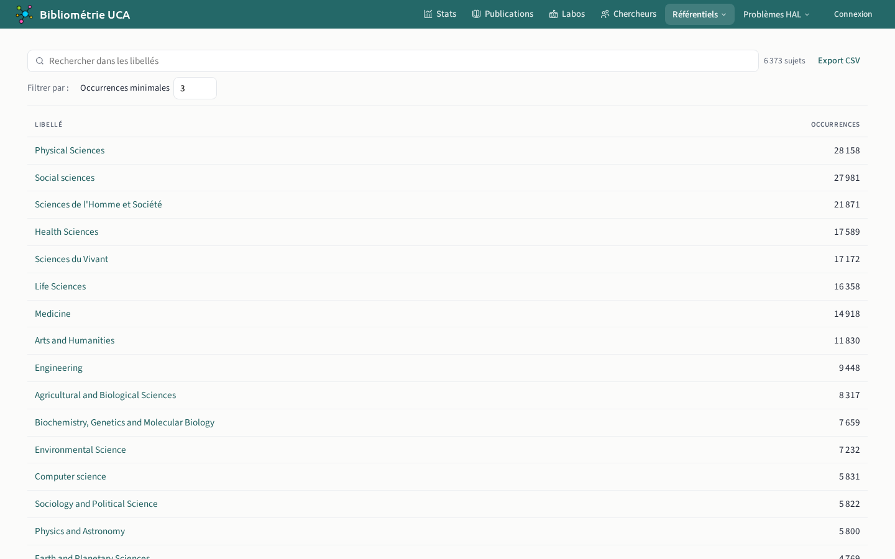
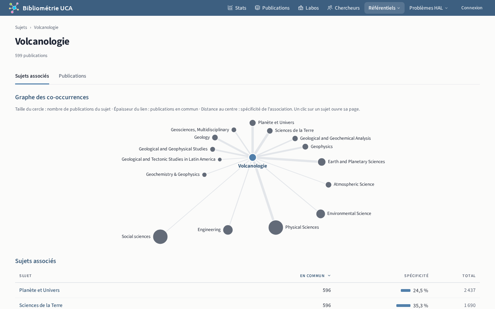

# Sujets

## Liste `/subjects`

Thématiques attribuées aux publications par les sources. Un sujet réunit les termes de même libellé de tous les vocabulaires : domaines HAL, classement OpenAlex, vedettes RAMEAU, disciplines de thèse.

## Détails `/subjects/{id}`

La page d'un sujet donne sa place dans chaque vocabulaire : sujets parents et sous-sujets. Le graphe des sujets associés relie les sujets qui apparaissent dans les mêmes publications.

