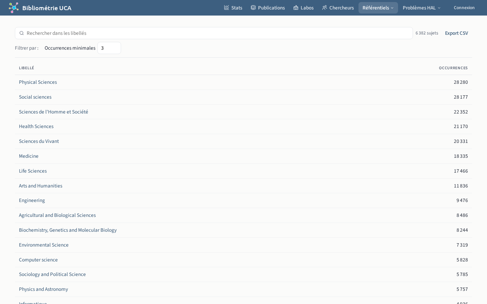
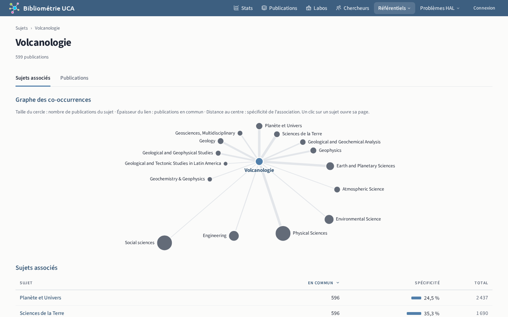

# Sujets

## Liste `/subjects`

Thématiques que les sources attribuent aux publications.

## Détails `/subjects/{id}`

Le graphe des sujets associés relie les sujets qui apparaissent dans les mêmes publications.

