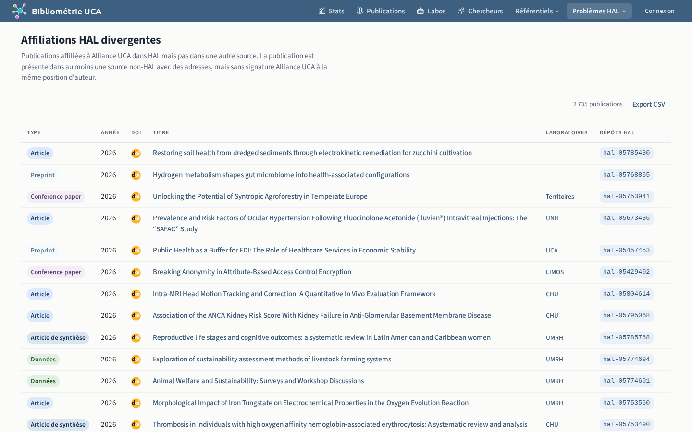

# Problèmes HAL

`/hal-problems/*`

Pages qui relèvent les problèmes de qualité propres à HAL :

- **Comptes auteur en double** : auteurs HAL qui ont plusieurs comptes ;
- **Dépôts en double** : dépôts HAL d'une même publication ;
- **Publications absentes des collections** : publications HAL absentes de la [collection HAL](../../glossaire.md#collection-hal) de leur laboratoire ;
- **Affiliations divergentes** : publications affiliées à l'établissement dans HAL, sans cette affiliation dans WoS et OpenAlex.

