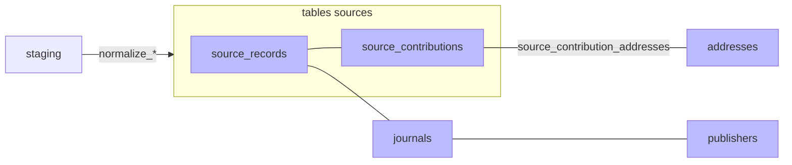

#  Normalisation

*À jour le 2026-10-21.*

Phase `normalize` : transforme les données brutes (`staging`) en tables structurées propres à chaque source — `source_records` et `source_contributions`. Peuple au passage les référentiels `publishers` et `serials`, et crée les `addresses` ainsi que les liens `source_contribution_addresses` qui rattachent une contribution source d'auteur à ses adresses.

Le conteneur d'un livre ou d'un chapitre sans ISSN est le livre lui-même : son titre reste dans `container_title`, sans créer de revue. Seul un recueil d'actes existant de même titre le rattache. Les plateformes d'ebooks d'OpenAlex ne créent pas de revue.

Chaque normaliseur reporte dans `source_contributions` ce que sa source fournit pour chaque contribution source : identifiants de l'auteur (ORCID, IdRef…) et affiliations. Chaque identifiant prend sa forme canonique ; une valeur mal formée est écartée et journalisée.

Une contribution source collective (collaboration, consortium, groupe d'étude…) reste à sa position, marquée `collective`. La marque vient de la source quand elle distingue les collectifs : entrée Crossref à `name` seul, créateur DataCite `Organizational`. Sinon, une règle sur le nom décide (`domain/persons/collective_names.py`).

Le type de document et la langue de la source sont traduits dans le vocabulaire du référentiel : `doc_type` par la table de correspondance de la source, `language` par les formes de `language_forms`. `raw_doc_type` et `raw_language` gardent la valeur de la source. Un type absent de la table de la source devient `other` et est journalisé. Une langue absente du référentiel, comme `und`, devient NULL.

Chaque normaliseur pose aussi la licence de l'enregistrement source (`source_records.license`), ramenée au vocabulaire fermé de `domain/publications/licenses.py`. La forme brute reste dans `source_extras`.

En fin de phase, les `source_records` d'un document marqué `disappeared_at` par [`fetch_stale`](02-harvest.md#documents-périmés-et-disparus-fetch_stale) sont supprimées ; leurs `source_contributions` sont supprimées en cascade. La ligne de `staging` reste, avec sa marque.

Conservés en base, les payloads bruts la font grossir hors de proportion avec les données normalisées qu'on en tire. En fin de phase, le `raw_data` du staging est donc vidé, puis un `VACUUM` récupère l'espace.

## Synchronisation des contributions sources

Chaque contribution source entrante est rapprochée d'une contribution source en base aux mêmes informations du contributeur (nom, prénom et identifiants normalisés, marque collective), puis de même position si ces informations sont répétées. Une contribution source rapprochée garde son identifiant, donc sa personne et son épinglage. Les autres sont insérées ou supprimées.

Un enregistrement source dont la partie auteurs du payload est inchangée depuis la dernière normalisation garde ses contributions sources en l'état. L'option `--normalize-full` vide l'empreinte de cette partie pour tous les enregistrements sources des sources normalisées : leurs contributions sources se resynchronisent à leur prochaine normalisation.
## Archivage du payload brut

Avant de vider `raw_data`, la normalisation dépose le payload hors base, dans le [raw store](../../infrastructure/raw_store/) : un fichier `data/raw_store/{source}/{source_id}.json.gz` par document. L'option [`--raw-store`](../exploitation/03-pipeline.md#divers) déclenche cet archivage : sans elle, le payload est perdu à la vidange. Cette option est inopérante en production, où la racine du conteneur est en lecture seule.

Le script `interfaces/cli/maintenance/rehydrate_staging_from_raw_store.py` réinjecte les payloads d'une source, pour rejouer sa normalisation.
