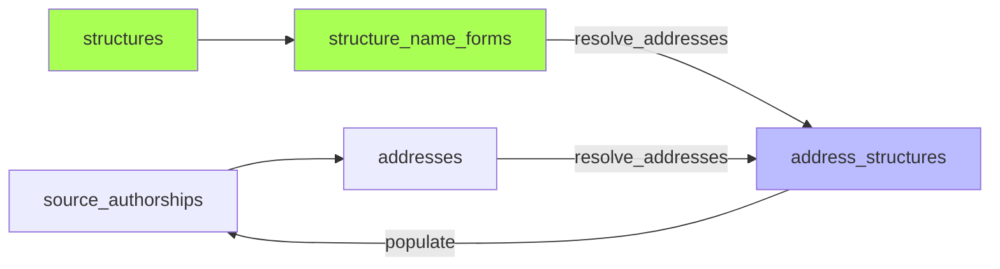

# Résolution des affiliations

*À jour le 2026-10-13.*

La phase `affiliations` reconnaît les structures dans le texte des adresses, et marque les signatures rattachées au périmètre.

1. **`refresh_ror`** — importe la dernière version du dump ROR, publié sur Zenodo, si elle n'est pas déjà importée.

2. **`resolve_addresses`** — rapproche chaque adresse normalisée des structures connues, en cherchant leurs formes de nom (`structure_name_forms`) dans le texte de l'adresse. Le résultat est écrit dans `address_structures`, avec `matched_form_id` pour la traçabilité (quelle forme a déclenché la détection). Code : `pipeline/transformation/structures/address_resolution.py`.

   La résolution cherche les formes de nom comme sous-chaînes du texte de l'adresse, à l'aide d'un [automate d'Aho-Corasick](https://tryalgo.org/fr/strings/2024/09/11/aho-corasick/). Trois garde-fous limitent les faux positifs :
   - une forme courte ou marquée « mot entier » ne compte que si elle est délimitée par des non-lettres ;
   - une forme « à contexte requis » n'est retenue que si une autre structure (en général sa structure de tutelle) est elle aussi reconnue dans l'adresse ;
   - une forme « excluante » interdit la reconnaissance d'une structure dans l'adresse qui contient cette forme.

3. **`populate`** — rafraîchit la vue matérialisée `source_authorship_structures`, qui rattache chaque signature aux structures de ses adresses. Le drapeau `in_perimeter` des `source_authorships` se déduit de cette vue : une signature est `in_perimeter` dès qu'une de ses structures appartient au périmètre. Une signature entre aussi dans le périmètre quand elle contient un identifiant fort (ORCID, IdRef, `hal_person_id`) d'une personne RH, et que le document paraît pendant son contrat. Un document sans publication dont une signature entre dans le périmètre est signalé à la phase [`publications`](07-publications.md), qui le met en publication. Code : `pipeline/transformation/structures/affiliations.py`.
