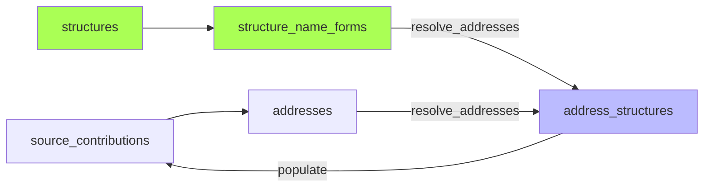

# Résolution des affiliations

*À jour le 2026-10-15.*

La phase `affiliations` rattache les contributions sources aux structures du périmètre, et marque leur entrée dans le périmètre.

1. **`refresh_ror`** — importe la dernière version du dump ROR, publié sur Zenodo, si elle n'est pas déjà importée. Une organisation qui change de pays marque pour la phase [`countries`](11-enrichissements.md#pays-des-adresses-countries) les contributions sources et les adresses qui la citent.

2. **`refresh_hal_structures`** — charge depuis l'API HAL les structures citées par les contributions sources et absentes du référentiel `ref.hal_structures`, puis leurs parents. Une structure qui change de pays marque pour la phase `countries` les contributions sources qui la citent.

3. **`resolve_addresses`** — rapproche chaque adresse normalisée des structures connues, en cherchant leurs formes de nom (`structure_name_forms`) dans le texte de l'adresse. Le résultat est écrit dans `address_structures`, avec `matched_form_id` pour la traçabilité (quelle forme a déclenché la détection). Code : `pipeline/transformation/structures/address_resolution.py`.

   La résolution cherche les formes de nom comme sous-chaînes du texte de l'adresse, à l'aide d'un [automate d'Aho-Corasick](https://tryalgo.org/fr/strings/2024/09/11/aho-corasick/). Trois garde-fous limitent les faux positifs :
   - une forme courte ou marquée « mot entier » ne compte que si elle est délimitée par des non-lettres ;
   - une forme « à contexte requis » n'est retenue que si une autre structure (en général sa structure de tutelle) est elle aussi reconnue dans l'adresse ;
   - une forme « excluante » interdit la reconnaissance d'une structure dans l'adresse qui contient cette forme.

4. **`resolve_thesis_partners`** — rattache le PPN IdRef de chaque laboratoire partenaire de thèse à une structure, par les formes de noms (`idref_structures`).

5. **`populate`** — rafraîchit la vue matérialisée `source_contribution_structures`, qui rattache chaque contribution source aux structures du périmètre qu'elle atteint, avec l'indice : adresse, ROR, structure HAL, établissement de soutenance ou laboratoire partenaire d'une thèse. Une contribution source entre aussi dans le périmètre quand elle contient un identifiant fort (ORCID, IdRef, `hal_person_id`) d'une personne qui a une fiche RH, et que le document paraît entre l'année qui suit son arrivée et la fin de son contrat. Ces indices sont écrits dans `source_contributions.perimeter_evidence` ; `in_perimeter` est vrai quand la contribution source en a au moins un. Un document sans publication dont une contribution source entre dans le périmètre est signalé à la phase [`publications`](07-publications.md), qui le met en publication. Code : `pipeline/transformation/structures/affiliations.py`.
