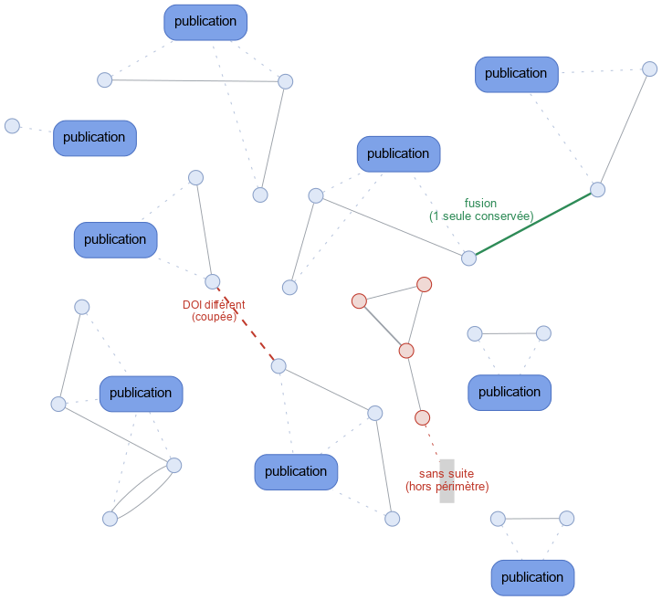

# Création et résolution des publications

*À jour le 2026-11-20.*

La phase `publications` maintient les [publications](../donnees/03-publications.md) à partir des enregistrements sources. Une publication regroupe tous les enregistrements sources qui décrivent le même document, quelles que soient leurs sources. La tâche `reconcile` rattache chaque enregistrement source à sa publication, en crée une au besoin, et fusionne ou scinde les publications existantes quand le regroupement le commande.

## Reconnaître la même publication

Deux enregistrements sources désignent la même publication s'ils partagent une **clé de confirmation**.

- **Identifiants** : DOI, NNT (numéro national de thèse), identifiant HAL, PMID (PubMed), numéro de fiche du CERN Document Server. Égalité directe. Un identifiant arXiv devient à la normalisation le DOI du dépôt (`10.48550/arxiv.<identifiant>`). Seuls comptent les identifiants actifs ; un DOI `related` désigne une autre œuvre et reste hors des clés. Le DOI d'une forme secondaire (version, variante) cède la place à sa cible (`doi_targets`).
- **Bloc de métadonnées** : le triplet `type de document | titre normalisé | année`. Deux documents de même type, même titre et même année sont tenus pour identiques. Une longueur minimale de titre écarte les collisions de titres trop génériques.

`domain/source_records/keys.py` calcule ces clés, à partir des métadonnées et des identifiants laissés actifs par la phase `metadata_correction`.

## Regrouper, puis rattacher

Les enregistrements sources reliés par au moins une clé partagée forment les **composantes connexes** d'un graphe.

Une règle prime sur le regroupement : **deux ancres distinctes désignent deux documents distincts**. Les ancres d'une composante sont ses DOI `primary` ou `derived`, à défaut le DOI des enregistrements sources à DOI unique. Les DOI de dépôt restent hors des ancres : DOI d'un serveur de preprints ou d'une archive de copies (DESY, RWTH, GSI, ResearchGate) du registre des plateformes, DOI Zenodo d'un dépôt de texte. Un preprint ou une copie rejoint ainsi la publication de sa version publiée. Une composante à plusieurs ancres est découpée en une partition par ancre. Un enregistrement source rejoint l'ancre de son DOI `primary` ou `derived`, sinon l'unique ancre parmi ses autres DOI. Un enregistrement source dérivé suit l'ancre de son parent, l'enregistrement source dont l'identifiant primaire est son identifiant `derived`. Sans parent, les enregistrements sources de même identifiant `derived` suivent l'unique ancre parmi les leurs. Les enregistrements sources restants forment des sous-composantes par leurs clés partagées. Une sous-composante reliée à une seule ancre la rejoint. Une sous-composante reliée à plusieurs ancres rejoint l'unique ancre de même type de document, à défaut elle forme sa propre partition.

Chaque partition aboutit à une seule publication :

- **Rattachement** : la partition contient une publication existante. Tous ses enregistrements sources sont rattachés à cette publication.
- **Fusion** : la partition réunit plusieurs publications existantes. Une seule est conservée, les autres sont absorbées.
- **Scission** : une publication existante est à cheval sur plusieurs partitions. Elle reste sur l'une d'elles, et une publication est créée pour chacune des autres.
- **Création** : la partition ne contient aucune publication. Une publication est créée si au moins un enregistrement source de la partition est dans le périmètre.
- **Sans suite** : à défaut, les enregistrements sources de la partition restent orphelins.

Le périmètre conditionne seulement la création : un enregistrement source hors périmètre peut rejoindre une publication existante.

*Chaque sommet du graphe est un enregistrement source. Une arête pleine relie deux enregistrements sources qui partagent une clé de confirmation. Une ligne en pointillés rattache un enregistrement source à sa publication (boîtes).*

## Traitement incrémental

Un enregistrement source modifié (inséré, normalisé de nouveau, corrigé) est marqué *à recalculer*. La phase traite seulement le **voisinage direct** de ces enregistrements sources, c'est-à-dire ceux qui partagent une clé avec eux.

Après une modification de la logique de résolution, l'option `--rebuild-publications` marque toutes les publications *à recalculer*, pour appliquer le changement au stock.

## Recalcul des métadonnées

La consolidation calcule seule les métadonnées d'une publication, depuis ses enregistrements sources. La réconciliation recalcule les publications qu'elle touche. La tâche `consolidate_publications` recalcule ensuite les publications de la file `publications_queue` : un enregistrement source a changé de pays, ou la réponse de doi.org ou d'Unpaywall sur leur DOI a changé. Le DOI de la publication est l'ancre de ses enregistrements sources, à défaut un DOI de dépôt. Dans une publication qui a une version publiée, les enregistrements sources preprint passent après les autres dans le classement des sources. Une publication a une version publiée quand ses enregistrements sources ont une ancre, ou quand un enregistrement source typé autrement que preprint a une revue ou une monographie. La date de publication est celle du premier enregistrement source selon le classement des sources. Les enregistrements sources suivants la précisent quand ils concordent : même année, et même mois quand la date retenue est au mois. L'éditeur est celui de la date de publication : le titulaire du préfixe du DOI Crossref, à défaut le premier éditeur des enregistrements sources selon le classement des sources. Les indicateurs de citation sont ceux du premier enregistrement source OpenAlex selon le classement des sources. Les pays réunissent ceux des enregistrements sources. Une publication sans enregistrement source est supprimée.

**Statut open access.** Une URL de résolution du DOI donne une copie ouverte de la publication dans deux cas : elle mène à une plateforme en accès libre intégral (arXiv, bioRxiv, medRxiv, PubMed Central), ou son chemin finit par `.pdf`. OpenAlex déclare ouverte la page de presque tout DOI DataCite : hors archive et sans licence, l'ouverture de cette copie est inconnue. Le statut se déduit des copies, du modèle de la revue et du verdict d'Unpaywall (`domain/publications/open_access.py`) :

1. Copie ouverte chez l'éditeur, sous licence ouverte : `hybrid` dans une revue sur abonnement ou de modèle inconnu, `gold` dans une revue entièrement en open access ou hors revue, `diamond` dans une revue diamant.
2. Sinon, copie ouverte dans une archive ou sur un serveur de preprints : `green`.
3. Sinon, copie ouverte chez l'éditeur sans licence ouverte : `bronze`.
4. Sinon : `embargoed` avec un enregistrement source sous embargo actif (`embargoes`), `closed` avec une copie déclarée fermée, un verdict, ou pour une thèse en cours ou réservée à l'intranet de son établissement, `unknown` sans aucune information.

Le modèle de la revue est celui de l'année de parution. Une revue entièrement en open access ou diamant est sur abonnement avant l'année de son passage à l'open access intégral, donnée par OpenAlex, sinon par le DOAJ. Sans cette année, son modèle est inconnu, sauf pour une revue née en open access intégral d'après OpenAlex.

Le verdict d'Unpaywall relève les accès chez l'éditeur, sans les abaisser : `gold`, `hybrid` ou `diamond` vaut une copie ouverte chez l'éditeur sous licence, `bronze` sans licence. Un verdict `green` vaut seulement information sur la publication, donc `closed` sans copie ouverte connue. Seule une copie d'archive connue par les sources donne `green` : Unpaywall classe en archive des plateformes d'éditeurs (OpenEdition, Cairn), compte comme ouverts les dépôts HAL sans fichier et ignore l'embargo d'un dépôt. Un brevet a le statut `unknown`.
