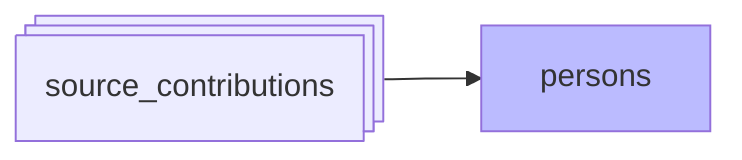

#  Résolution et création des personnes

*À jour le 2026-10-09.*

La phase `persons` rattache chaque contribution source à une personne, et crée les personnes que les sources font apparaître. Une contribution source est un auteur tel qu'une source le donne sur une publication : un même chercheur en produit une par publication et par source.

## Rattacher une contribution source à une personne

Les critères sont interrogés dans l'ordre, du plus fiable au moins fiable. Le premier qui désigne une personne l'emporte.

1. **ORCID déposé par l'auteur** : ORCID présent dans les métadonnées Crossref ou DataCite de la publication, dans le `raw_orcid` d'OpenAlex, ou dans le TEI HAL (`label_xml`). Les ORCID que la source a devinés sont écartés : `author.orcid` dans OpenAlex, distingué de `raw_orcid` ; dans WoS, où les deux sont indiscernables, `PreferredORCID` est ignoré en entier.

2. **Compte HAL** : `hal_person_id`, attaché à la contribution source dans le TEI. Vient après l'ORCID déposé : le rattachement de la contribution source au compte peut être faux, du fait de l'identification automatisée au dépôt et des homonymies sur les publications à nombreux auteurs.

3. **Identifiant IdRef** : PPN SUDOC (HAL TEI, ScanR, theses.fr), référentiel personnes de l'ESR.

4. **Forme de nom** : le nom normalisé de la contribution source désigne une seule personne dans `person_name_forms`, ou, à défaut, une seule personne aux initiales compatibles (« Abdellah Tnourji » rejoint « Tnourji A. »). Ce référentiel de formes est régénéré à chaque exécution, à partir du nom de chaque personne — « prénom nom » et « initiales nom » — et du nom porté par ses contributions sources. Une contribution source est cherchée sous la forme « prénom nom », puis « nom prénom », ce qui rattrape un nom et un prénom inversés par la source. Un nom qui désigne plusieurs personnes laisse la contribution source orpheline, pour traitement manuel via `admin/orphan-contributions`.

5. **Même publication, même position, dans une autre source** : une autre source donne la même publication, avec à la même position d'auteur une contribution source déjà rattachée à une personne, dont le nom est compatible. Interrogé en dernier : il s'appuie sur les rattachements que les critères précédents viennent de poser.

> **Corroboration par le nom.** Un match par identifiant (ORCID, `hal_person_id`, IdRef) n'est retenu que si le nom de la contribution source est compatible avec celui du propriétaire de la valeur : un identifiant recopié sur le mauvais co-auteur est refusé, la contribution source retombe sur les critères suivants.

> **Garde de rejet.** À chaque critère, les personnes rejetées manuellement pour la publication (une publication est rejetée pour une personne dès qu'un de ses enregistrements sources l'est, `rejected_contributions`) sont **éliminées des candidats** : un match ne peut pas recréer une paire rejetée. L'élimination peut aussi **désambiguïser** une recherche par nom : si une forme ambiguë correspond à 2 personnes dont l'une est rejetée pour cette publication, il ne reste qu'une candidate et le rattachement devient univoque.

### Rattacher, puis créer

La phase fait deux passes sur ces critères.

- La première rattache seulement, sans jamais créer de personne.
- La seconde reprend les contributions sources restées orphelines : aucun identifiant ne les a prises. Elle les rejuge sur la forme de nom et sur la position dans une autre source. Un nom inconnu donne alors une personne neuve. Cette seconde passe voit les rattachements posés par la première.

### Contributions sources hors périmètre

Une contribution source hors périmètre ne peut pas donner lieu à une création de personne.

Elle peut être rattachée à une personne existante, soit par identifiant, soit par sa présence dans une autre source. Le critère de similitude de nom ne vaut que pour les contributions sources du périmètre. 

### Contributions sources collectives

Une contribution source collective n'est rattachée à aucune personne, et ne compte pas dans l'arbitrage des identifiants.

## Indépendance de l'ordre d'ingestion

Le résultat ne dépend pas de l'ordre dans lequel les sources ont été moissonnées. La phase ne fige aucun rattachement dérivé : à chaque exécution, elle les rejuge tous contre l'état ferme de tout le corpus.

## Données préservées

Les saisies manuelles (épinglage d'une contribution source, formes de nom confirmées ou rejetées, personnes déclarées distinctes) et les données importées (fiches du référentiel RH) sont des entrées fixes, jamais réinitialisées.

Une personne qui perd toutes ses contributions sources est supprimée, sauf si elle est présente dans le référentiel RH ou fait l'objet d'une décision humaine.