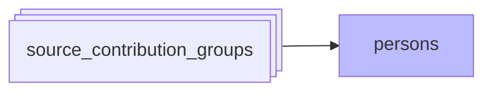

#  Résolution et création des personnes

*À jour le 2026-10-24.*

La phase `persons` rattache chaque contribution à une personne. Une contribution source est un auteur tel qu'une source le donne sur une publication : un même chercheur en produit une par publication et par source. La phase `author_grouping` réunit les contributions sources d'un même auteur d'une publication en un groupe (`source_contribution_groups`). Une contribution est un groupe rattaché à une personne. La phase décide la personne de chaque groupe à partir de tous ses membres.

Un groupe du périmètre au nom inconnu fonde une personne, d'après le nom de son meilleur membre : autorisé à créer une personne, de préférence du périmètre, d'une source qui sépare nom et prénom, au prénom plein le plus long. Les groupes au même nom, dans d'autres publications, la rejoignent dans le même passage.

## Rattacher un groupe à une personne

Les critères sont interrogés dans l'ordre, du plus fiable au moins fiable. Le premier qui désigne une personne l'emporte. Deux personnes désignées par le même critère laissent le groupe sans personne.

1. **Épinglage** : un membre du groupe est épinglé à une personne par l'administration.

2. **ORCID déposé par l'auteur** : ORCID présent dans les métadonnées Crossref ou DataCite de la publication, dans le `raw_orcid` d'OpenAlex, ou dans le TEI HAL (`label_xml`). Les ORCID que la source a devinés sont écartés : `author.orcid` dans OpenAlex, distingué de `raw_orcid` ; dans WoS, où les deux sont indiscernables, `PreferredORCID` est ignoré en entier.

3. **Compte HAL** : `hal_person_id`, attaché à la contribution source dans le TEI. Vient après l'ORCID déposé : le rattachement de la contribution source au compte peut être faux, du fait de l'identification automatisée au dépôt et des homonymies sur les publications à nombreux auteurs.

4. **Identifiant IdRef** : PPN SUDOC (HAL TEI, ScanR, theses.fr), référentiel personnes de l'ESR.

5. **Forme de nom** : le nom normalisé d'un membre désigne une seule personne dans `person_name_forms`, ou, à défaut, une seule personne aux initiales compatibles (« Abdellah Tnourji » rejoint « Tnourji A. »). Ce référentiel de formes est régénéré à chaque exécution, à partir du nom de chaque personne — « prénom nom » et « initiales nom » — et du nom des membres de ses groupes. Un membre est cherché sous la forme « prénom nom », puis « nom prénom », ce qui rattrape un nom et un prénom inversés par la source. Un nom qui désigne plusieurs personnes laisse le groupe sans personne, pour traitement manuel via `admin/orphan-contributions`.

Dans une publication, une personne revient à un seul groupe : le mieux appuyé (épinglage, puis identifiant, puis nom).

> **Corroboration par le nom.** Un match par identifiant (ORCID, `hal_person_id`, IdRef) n'est retenu que si le nom du membre qui le contient est compatible avec celui du propriétaire de la valeur : un identifiant recopié sur le mauvais co-auteur est refusé.

> **Garde de rejet.** À chaque critère, les personnes rejetées manuellement pour la publication (une publication est rejetée pour une personne dès qu'un de ses enregistrements sources l'est, `rejected_contributions`) sont **éliminées des candidats** : un match ne peut pas recréer une paire rejetée. L'élimination peut aussi **désambiguïser** une recherche par nom : si une forme ambiguë correspond à 2 personnes dont l'une est rejetée pour cette publication, il ne reste qu'une candidate et le rattachement devient univoque.

### Groupes hors périmètre

Un groupe sans membre du périmètre est rattaché seulement par épinglage ou par identifiant. Le critère de similitude de nom vaut seulement pour les groupes du périmètre.

### Contributions sources hors groupe

Les contributions sources collectives, les doublons d'auteur et les contributions sources des enregistrements sources écartés de l'alignement restent hors groupe. Elles n'ont pas de personne et ne comptent pas dans l'arbitrage des identifiants.

## Rattachements conservés d'un run à l'autre

La phase décide les groupes sans personne. Un groupe rattaché garde sa personne d'un run à l'autre. Il la perd dans quatre cas :

- ses membres changent (phase `author_grouping`) ;
- l'arbitrage des identifiants neutralise l'identifiant qui l'a rattaché, ou le transfère à une autre personne ;
- la forme de nom qui fonde un rattachement par nom désigne plusieurs personnes (purge) ;
- la personne est supprimée.

## Données préservées

Les saisies manuelles (épinglage d'une contribution source, formes de nom confirmées ou rejetées, personnes déclarées distinctes) et les données importées (fiches du référentiel RH) sont des entrées fixes, jamais réinitialisées.

Une personne sans contribution du périmètre est supprimée, sauf si elle est présente dans le référentiel RH ou fait l'objet d'une décision humaine. Ses groupes perdent leur personne.
