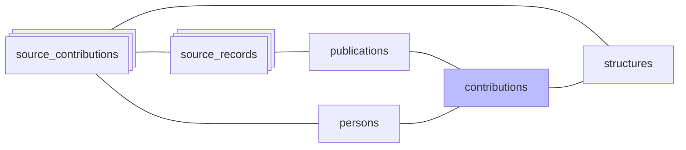

#  Contributions

*À jour le 2026-09-06.*

La phase `contributions` consolide en une table les contributions sources que rapportent toutes les sources : une ligne par couple publication-personne, dont les attributs résument ce que ces sources en disent. La construction est incrémentale et convergente — les attributs divergents sont réécrits, les paires que plus aucune source n'atteste sont supprimées — si bien qu'une relance aboutit au même état.

1. **Insertion** des paires (publication, personne) manquantes, **sauf** les paires rejetées : une publication est rejetée pour une personne dès qu'un de ses enregistrements sources l'est (`rejected_contributions`). Une contribution source confirmée à la personne l'emporte sur le rejet.
2. **Élagage** des contributions orphelines : les paires que plus aucune `source_contribution` n'atteste sont supprimées.
3. **Recomposition des attributs**, en une passe, depuis les contributions sources qui attestent chaque contribution : même publication par leur enregistrement source, même personne. `author_position` vient de la source la plus prioritaire qui le renseigne : theses > Crossref > DataCite > HAL > OpenAlex > ScanR > WoS. `is_corresponding`, `in_perimeter` et `roles` sont des unions : les booléens sont vrais dès qu'une source les porte.
4. **Report sur les publications** : `publications.in_perimeter` est matérialisé, pour que les filtres de liste lisent un drapeau au lieu de recalculer l'appartenance au périmètre à chaque requête.
5. **Rafraîchissement des vues matérialisées** `group_structures` et `publication_structures`, qui rattachent groupes de contributions sources et publications à leurs structures.

## Opérations finales

- **Purge des publications** : une publication sans enregistrement source ou sans contribution est supprimée. Elle perd son dernier enregistrement source quand le document disparaît de sa source, et sa dernière contribution quand elle sort du périmètre.
- **Suppression des référentiels vides**, dans cet ordre, car une monographie maintient sa collection, une revue ou un préfixe DOI son éditeur :
  - les monographies sans enregistrement ni publication ;
  - les revues sans enregistrement, sans publication, sans monographie et sans paiement APC, avec leurs formes de nom. Le journal d'exécution garde le titre, l'éditeur et les ISSN de chaque revue supprimée ;
  - les éditeurs sans revue, sans monographie, sans préfixe DOI, sans paiement APC et sans forme de nom de revue.

  Elle suit les dernières suppressions de publications : un référentiel vidé dans le run est supprimé dans le même run.
- **Recalcul des `publication_count`** des adresses, des revues et des éditeurs, qui dérivent du nombre de publications du périmètre.
