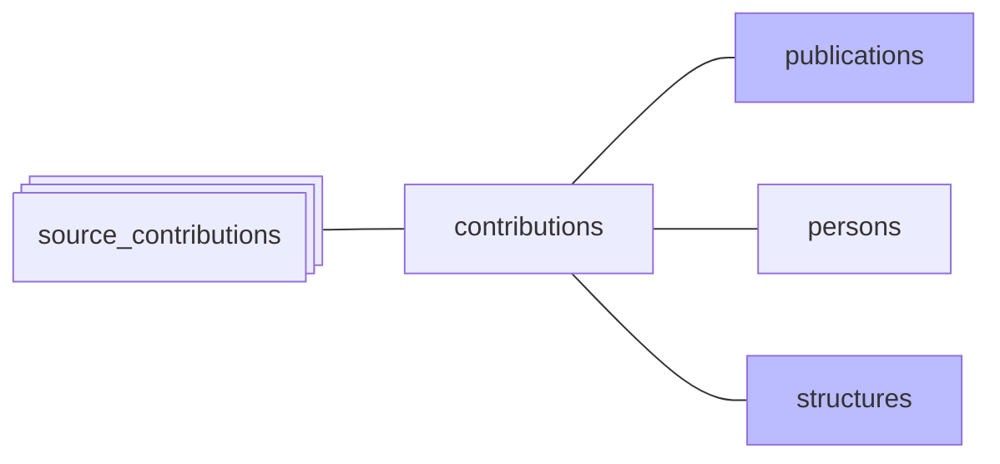

#  Contributions

*À jour le 2026-10-24.*

Une contribution est un groupe de contributions sources (`contributions`) rattaché à une personne : les contributions sources d'un même auteur d'une publication, une par enregistrement source au plus. La phase `author_grouping` forme les groupes, la phase `persons` et les décisions de l'administration leur donnent une personne. La phase `contributions` reporte les contributions sur les publications et les structures.

1. **Report sur les publications** : `publications.in_perimeter` est matérialisé, pour que les filtres de liste lisent un drapeau au lieu de recalculer l'appartenance au périmètre à chaque requête.
2. **Rafraîchissement des vues matérialisées** `contribution_structures` et `publication_structures`, qui rattachent groupes de contributions sources et publications à leurs structures.

## Opérations finales

- **Purge des publications** : une publication sans enregistrement source ou sans contribution est supprimée. Elle perd son dernier enregistrement source quand le document disparaît de sa source, et sa dernière contribution quand son dernier groupe rattaché à une personne perd sa personne.
- **Suppression des référentiels vides**, dans cet ordre, car une monographie maintient sa collection, une revue ou un préfixe DOI son éditeur :
  - les monographies sans enregistrement ni publication ;
  - les revues sans enregistrement, sans publication, sans monographie et sans paiement APC, avec leurs formes de nom. Le journal d'exécution garde le titre, l'éditeur et les ISSN de chaque revue supprimée ;
  - les éditeurs sans revue, sans monographie, sans préfixe DOI, sans paiement APC et sans forme de nom de revue.

  Elle suit les dernières suppressions de publications : un référentiel vidé dans le run est supprimé dans le même run.
- **Recalcul des `publication_count`** des adresses, des revues et des éditeurs, qui dérivent du nombre de publications du périmètre.
